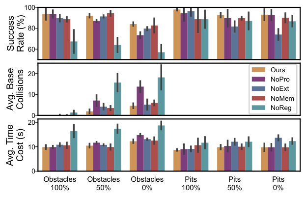
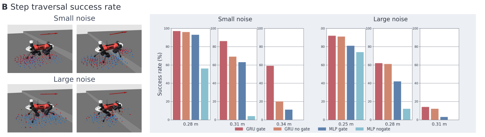
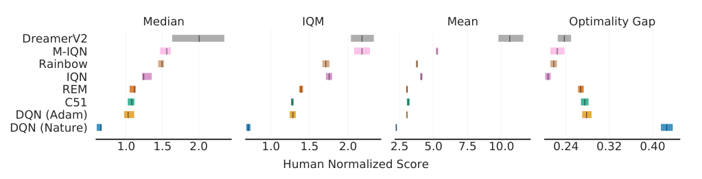
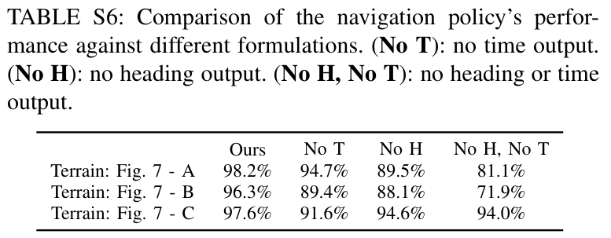

# 模块消融图：调研、现有数据与设计建议

日期：2026-10-25。对象：CCDC 1020 稿的模块消融部分。本轮只做文献调研、数据核对和图形设计；没有绘制本文的新实验图，没有修改论文或实验数值。

## 1. 这张图要回答什么

论文的核心是把 RC-PPO/MCRA 接入真实四足机器人的执行闭环。冻结速度跟踪器提供一致的接口；成本裕度 α 修正名义成本低估；几何裕度 δ 修正执行路径偏离。模块消融图要检验后面两个修正各自的作用，以及两者结合后的成功、安全和成本取舍。

与现有图片分工如下：总览图解释模块如何连接；轨迹与同步曲线解释单个案例中的过程；主结果图比较完整方法与其他方法；预算扫描图解释初始预算改变后的结果；模块消融图解释删除某项修正后发生什么变化。

此前 `CCDC/submission/1020审稿视角_结果缺口与绘图建议.md` 已提出四组配置：无裕度、仅 α、仅 δ、两者都有，并同时检查 SR、CR、BVR 和执行成本。这一实验逻辑保留。原先建议的扰动扫描和二维裕度扫描属于另外的实验维度，不能由这四组汇总数延伸出来。

## 2. 本轮实际查了什么

复用现有论文库，对 21 份本地 PDF 筛查消融关键词；定向阅读 6 篇论文的 9 个完整相关页，并核对图注及对应实验说明。另完成 3 组在线检索和 6 个 arXiv 原文页面核验。在线检索返回的候选条目不等于详细阅读数量。

详细证据位于本目录：

- `literature_scan.json`：21 份 PDF 的关键词筛查。
- `selected_source_pages.json`：6 篇重点论文的相关页原文、页码和源文件哈希。
- `online_search.json`：网页检索、候选链接和原文标题核验。
- `current_ablation_snapshot.json`：论文当前消融数值、配置映射和相对完整方法的差值。
- `figure_cases.json`：本轮截取的原图坐标。
- `review_ablation.py`：重现检索与核对的脚本，`--figures-only` 只重新截取原图。

以下图号和页码对应本地归档 PDF，不默认等于网站最新版本。

## 3. 原文案例及可借鉴之处

### 3.1 Resilient：同一套删模块配置，多个指标上下对应

[Resilient Legged Local Navigation](https://arxiv.org/abs/2310.03581)，Fig. 8，本地 PDF 第 5 页。

图中完整方法和四个删模块版本使用固定颜色，三个面板分别报告成功率、平均机身碰撞计数和时间成本；每个环境条件下都有同一组方法。

适合借鉴的是：模块删除后不能只看某一个有利指标，要把任务表现、安全和代价放在一起；不同面板保持相同配置身份和顺序。原文误差棒表示标准差。

我们只有四个受控裕度配置，无需照搬六种环境条件、密集柱体和重复标签。该文允许碰撞后恢复，平均碰撞计数并非我们定义的碰撞率 CR，不能借用其统计口径。

### 3.2 Robust Perceptive Locomotion：两个设计因素，四种组合

[Learning robust perceptive locomotion for quadrupedal robots in the wild](https://arxiv.org/abs/2201.08117)，Supplementary Fig. S2B，本地 PDF 第 22 页；解释见第 19–20 页。

论文比较 GRU gate、GRU no gate、MLP gate、MLP no gate 四种设置，并在不同噪声与台阶高度下报告跨越成功率，场景图辅助解释测试条件。

它最值得借鉴的是四组合逻辑：既单独删除每个因素，也删除两个因素。我们的对应配置正是 α/δ 均无、仅 α、仅 δ、α/δ 均有。

本文没有四配置对应的多噪声、多高度结果，不能照搬其条件扫描。已有轨迹图和总览图已经解释场景，消融图不必再加入机器人照片。

### 3.3 rliable：指标分面，方法对齐，用点和区间减少视觉负担

[Deep Reinforcement Learning at the Edge of the Statistical Precipice](https://arxiv.org/abs/2108.13264)，Fig. 9，本地 PDF 第 8 页。

每行是同一种算法，每列是不同指标。位置表达中心估计，横向区间表达不确定性，指标各有坐标尺度。原图区间是分层 bootstrap 95% 置信区间。

这不是模块消融实验；我们借鉴其对齐、少装饰和分面方式。建议在此基础上将“完整方法”和“删模块版本”画成两点，以细线连接，突出删除后的差值。这种配对点的改法是针对本文的设计建议，并不是说 rliable 原图已经使用了删模块配对。

### 3.4 ANYmal Parkour：完整数字可以留在简表

[ANYmal Parkour](https://arxiv.org/abs/2306.14874)，Table S6，本地 PDF 第 18 页。

其配置为完整方法、删除时间输出、删除朝向输出、同时删除两者。在三个地形条件下报告成功率，正文解释两个输出在不同地形中的作用。

可借鉴的是“配置定义清楚，数字由简表承载”。我们的新图可以突出删除后的变化，已有消融表保留全部数值、最小间隙和层级接口对照，避免每一项都挤入图中。

### 3.5 ABS：消融应允许真实取舍

[Agile But Safe](https://arxiv.org/abs/2401.17583)，Table VI，本地 PDF 第 12 页。

软化失败指示器后，论文报告的碰撞率降低，但成功率并不是同时升高。它说明模块有效可以表现为安全与任务表现之间的取舍，不需要所有指标都由完整方法获胜。

这对本文尤其重要：现有单裕度配置成本更低，但成功率也更低，不能为了画出“完整方法全面最好”而改变数据或隐藏指标。原表截取保存为 `figures/abs_table_vi.png`。

VAPOR 的 Table I（本地 PDF 第 6 页）也将删模块版本和完整指标保留在表中，以轨迹等结果解释行为，支持图表分工；本轮没有据此增加新的实验维度。

## 4. 当前可以直接使用的数据

以下全为论文已有的假设数据，本轮未新增或修正。已逐行核对 `CCDC/latex/1020/main.tex` 的 `tab:ablation_draft` 与 `CORL/scripts/generate_experiment_results_v3.py` 的 `ABLATION_ROWS`，两者一致。

| 配置 | α | δ | SR (%) ↑ | Cost | BVR (%) ↓ | CR (%) ↓ | MC (m) |
| --- | --- | --- | ---: | ---: | ---: | ---: | ---: |
| 完整 HD-MCRA | 开 | 开 | 73.3 | 88.3 | 9.0 | 15.0 | 0.31 |
| 去掉 α，仅 δ | 关 | 开 | 67.2 | 80.6 | 22.4 | 19.8 | 0.29 |
| 去掉 δ，仅 α | 开 | 关 | 64.8 | 77.2 | 13.8 | 26.3 | 0.19 |
| 两者均去掉，RC-PPO | 关 | 关 | 70.7 | 91.7 | 14.0 | 15.7 | 0.30 |

另有去掉层级接口的假设行：SR 47.9%，CR 38.8%，Cost 116.7，BVR 31.5%，MC 0.11 m。该对照同时改变动作接口和预训练等条件，不是单独检验冻结，也不是同一接口上的裕度开关，建议留在表中单独讨论。

### 4.1 最值得图形突出显示的关系

- 完整方法与去掉 α 对比：BVR 从 9.0% 上升到 22.4%，增加 13.4 个百分点；SR 下降 6.1 个百分点。
- 完整方法与去掉 δ 对比：CR 从 15.0% 上升到 26.3%，增加 11.3 个百分点；MC 从 0.31 m 降至 0.19 m；SR 下降 8.5 个百分点。
- 完整方法与无裕度 RC-PPO 对比：SR 高 2.6 个百分点，Cost 低 3.4，BVR 低 5.0 个百分点，CR 低 0.7 个百分点。

这些关系对应当前占位数值的叙述，尚不能构成实验结论。α 对 BVR、δ 对 CR/MC 的对应作用也不是彼此完全独立，两个模块都会改变规划与执行行为。

### 4.2 数据必须如实呈现的取舍

仅一个裕度时，Cost 分别为 80.6 和 77.2，低于完整方法的 88.3；但相应 SR 也更低。论文当前成本口径为所有试验在到达、碰撞或超时时的累计执行成本，更早失败可能降低成本，不能把这个最小值单独解释成效率最优。

四组数据不是单调递进：仅 α、仅 δ 在多个指标上不如无裕度 RC-PPO。必须把它们当作四个分类配置比较，不能用依次连线的折线暗示“每加一个模块都更好”。同样，四个角点不支持拟合连续 α/δ 热图，也不能证明两个修正具有可加的独立增益。

## 5. 推荐的本文图形

### 5.1 首选：四指标的配对点图

按最终单栏宽度约 88 mm 直接设计，建议两行两列：

| 左列 | 右列 |
| --- | --- |
| (a) SR (%) ↑ | (b) Executed cost |
| (c) BVR (%) ↓ | (d) CR (%) ↓ |

上排保留用户确定的两个核心指标 SR 和 Cost，下排解释两个裕度最直接对应的预算与几何风险。每个面板使用相同的三行：

1. w/o α：完整方法与去掉 α 比较。
2. w/o δ：完整方法与去掉 δ 比较。
3. w/o both：完整方法与无裕度 RC-PPO 比较。

每行用蓝点表示完整方法，用另一个颜色和形状表示当前删模块配置，中间用细灰线连接。点的坐标是绝对指标值，线段长度表示两个汇总值的差。图例只放一份；只在 BVR 的 w/o α 行与 CR 的 w/o δ 行选择性标注 +13.4 pp 和 +11.3 pp，避免满图数字。

蓝点在每行重复是相同完整方法的参照值，不是三个独立重复实验。细连接线既不是误差棒，也不是随参数或时间变化的曲线；“配对”指显示上把两个配置相对照，不代表已有逐试验配对统计证据。

四配置乘四指标共使用 16 个不同中心值，重复参照不新增数据。MC 留在表中，支持几何机制解释。去掉层级接口的行也留在表中，避免其大幅变化压缩 α/δ 的比较尺度。

### 5.2 为什么优先于大柱图、雷达图或四面板全横排

配对点图直接显示“删掉这项会变化多少”，比重复方法的完整柱体更节省空间；每个指标各用自己的单位和坐标，避免雷达图对 SR、成本和风险做任意归一化。

用户已要求图表单栏，因此需要在成稿尺寸检查文字。建议最终有效字号约 7–8 pt 起，关键标题不低于刻度文字；靠压缩间距而不是无限缩字号。单栏里横排四个带方法标签的面板容易过小，所以本图建议两行两列。之前对预算扫描图的横排要求仍然保留，不在本轮改动。

点图的横轴可以局部放大，但必须显示真实刻度，不能用面积暗示比例或隐藏截断。Cost 暂不加“越低越好”的单独优胜标记，必须结合 SR 与成本统计口径解释。

### 5.3 备选：四组简单柱状图

若更看重读者第一眼熟悉的图形，可借鉴 Resilient：每个指标一个面板、四配置固定顺序和配色、一个共享图例。柱状图以零为基线，图注统一交代假设数据性质。

它同样能使用现有数值，但更强调绝对高度，弱化“去掉 α/δ 的具体损失”，且和现有总体比较图重复更多。故本轮优先推荐配对点图，不同时新增两种正式图。

## 6. 数据够不够，后面缺什么

现有中心值足够先设计并绘制上述假设数据版本，无需运行新的仿真以获得排版预览。

目前未找到四配置对应的消融误差区间、按 seed 的原始结果、逐试验分布或训练历史。已有主比较图的假设区间不能直接移植给不同的消融配置。若要给消融增加假设区间，应单独记录其推演依据与数据性质；它们仍然不是测得的统计不确定性。本轮没有生成这些区间。

正式实验需记录配置、地图和起终点、训练 seed、每次成功与碰撞事件、执行成本、预算违规事件及最小间隙。CR 使用统一物理足迹，不能因为 δ 扩大规划危险集就改变碰撞判定。相同预算口径和评价集应贯穿四配置；是否每配置重新训练要明确。真实区间从相应重复试验计算，说明是标准差还是置信区间。

主比较图和预算扫描在参考预算处继续复用完整 HD-MCRA/RC-PPO 两行；本次图不重新生成它们。单次轨迹图的成本尺度与汇总表不同，不能为了数值相等而强行改成同一个数。

## 7. 验收要点

- 读者能看出 α 对应成本核算和 BVR，δ 对应几何裕度和 CR/MC，同时两者影响成功与成本。
- 图中的 16 个不同中心值与现有消融表逐项一致，零裕度和完整方法与主表一致。
- 四配置是分类对照；图形没有制造单调递进、统计显著性或独立可加收益。
- 保留单裕度配置的低成本和低成功率，不通过省略 Cost/SR 隐藏取舍。
- 全图单栏、最终尺寸可读、颜色与既有图保持方法身份一致，并辅以形状区分；连接线含义明确。
- 图注统一说明假设数据性质，数据说明保留来源；不把占位数值描述成实测结果。

以上是研究与设计建议，尚未执行新图绘制或替换论文。
