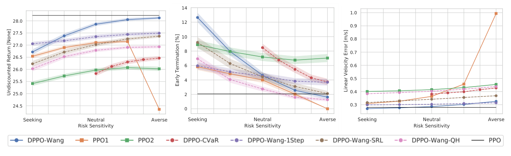
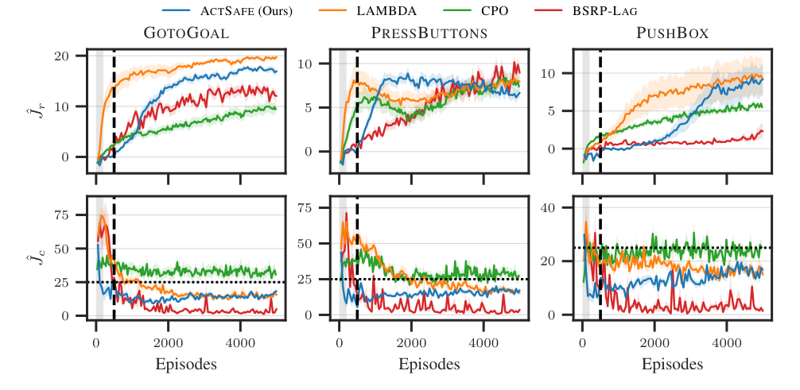

# 预算扫描图调研与视觉优化建议

日期：2026-10-24。对象：CCDC 1020 稿当前图4。此次只调研和提出设计建议，不修改论文、工作簿、已有假设值或成图。

## 结论

建议保留“预算作为横轴”的小多图，而不是换成柱状图、雷达图或热图。具体采用单栏紧凑2×2曲线图：第一行成功率、执行成本，第二行预算违规率、碰撞率。顶部只保留一个共享图例；下面增加一行简短的“最小通过测试预算”摘要。

这张图要回答：在相同验收标准下，各方法最低需要测试到多大的预算才能同时满足成功、安全与预算约束，以及放宽预算之后的变化。它和主表、总体方法对比图的分工不同。

## 检索范围及原图参考

直接通过 arXiv 检索三个主题：`"budgeted reinforcement learning"`、`"safe reinforcement learning" "budget"`、`"constrained policy" "sensitivity"`。三组返回记录分别为2、11、14条；这是候选检索记录数量，不是已读论文数，也未对跨组重复候选做独立文献计数。结合已有阅读集，实际检查下列6篇论文的相关完整图页。联网核对了6个论文落地页；新增下载预算强化学习论文1篇，其余复用本地原文。

普通搜索引擎访问出现验证页或不相关结果，相关文献发现以 arXiv 站内检索为准。查询、URL、状态、PDF哈希、阅读页文本保存在 [source_review.json](source_review.json)。本地旧PDF的版本不自动等同于线上最新版本，以下页码均指实际阅读的本地PDF。

| 论文与出处 | 它怎样组织图 | 我们借鉴什么 | 不能直接照搬什么 |
| --- | --- | --- | --- |
| [Learning Risk-Aware Quadrupedal Locomotion using Distributional Reinforcement Learning](https://arxiv.org/abs/2309.14246)，Fig.6，本地PDF第5页 | 三个参数响应面板、一个公共图例、不随参数变化的PPO参考线 | 共享参数轴、紧凑排版、RA的恒定SR/CR/成本画成水平线 | 风险参数不是我们的预算；其95%区间来自评价初始条件，训练仅单seed，不能当作我们的跨seed区间 |
| [ActSafe](https://arxiv.org/abs/2410.09486)，Fig.4，本地PDF第9页 | 上排回报、下排成本；共享图例，成本图画明确的水平约束线 | 任务表现与约束表现分开、验收阈值清晰可见 | 横轴为训练回合，不是预算；竖向阶段线、预热底色与本图无关；阴影为10个seed的标准误 |
| [Constrained Policy Optimization](https://arxiv.org/abs/1705.10528)，Fig.1，本地PDF第7页 | 同一任务上下对齐回报与约束，约束上限直接入图 | 用约束线告诉读者何时达标，而不只展示几条曲线 | 多任务十面板过密，不适合我们的单栏；训练迭代不能替换成预算 |
| [Solving Minimum-Cost Reach Avoid using Reinforcement Learning](https://arxiv.org/abs/2410.22600)，Fig.6，本地PDF第10页 | 在到达率—成本平面展示不同权重配置 | 成本必须结合完成任务的能力解释，不能只看低成本 | 它不是预算响应曲线；当前没必要再加一张重复的权衡散点图；不用其Pareto最优措辞解释有限预算点 |
| [Learning Navigation Behaviors End-to-End with AutoRL](https://arxiv.org/abs/1809.10124)，Fig.8，本地PDF第8页 | 随噪声强度变化的分面曲线，方法颜色、符号一致 | 有序参数用曲线，保留实际测试点 | 不复制重复小图例和较重底色；噪声强度与预算是不同变量 |
| [Budgeted Reinforcement Learning in Continuous State Space](https://arxiv.org/abs/1903.01004)，Fig.3，本地PDF第8页 | 不同预算/权重对应成本—收益位置，反映性能权衡 | 明确参数设置对应的位置，而非把扫描点当成无条件最优结果 | 多个大矩形不确定范围与密集参数标注不适合本稿单栏；它约束期望成本，与我们的逐回合BVR定义不同 |

最直接的视觉参考：





新下载论文的原文在 [papers/budgeted_rl.pdf](papers/budgeted_rl.pdf)，完整第8页和Fig.3原图截取位于 `previews/`。原图仅供内部阅读与绘图设计参考。

## 当前图为什么显得粗糙

1. 四个子图各放一份相同图例，字体约3.5pt，单栏读起来很吃力；图例还带重边框。
2. SR、CR、BVR统一使用0–100%，但CR仅在13–21.5%之间，绝大部分绘图区空白，曲线拥挤在底部。
3. 四周黑框、刻度、网格偏重，数据线较细；每个点带黑色描边，视觉层次不协调。
4. 八个预算标签全部显示，0.96、1.00、1.05位置靠近；读者难以扫读。
5. 指标名称放在下方，但缺少清晰的共同横轴名称，容易把指标名称误解成横轴含义。
6. 目前没有画SR≥60%、CR≤20%、BVR≤15%的验收线，读者必须对照正文才能知道哪个点开始达标。
7. 缺少最小通过测试预算的醒目标注，没把扫描实验的关键发现提炼出来。

## 推荐的具体排版

```text
              HD-MCRA   RC-PPO   RA    （共享图例）

       (a) Success rate ↑    (b) Execution cost
           三条曲线              三条曲线
           SR=60%阈值

       (c) Budget violation ↓ (d) Collision rate ↓
           三条曲线              三条曲线
           BVR=15%阈值           CR=20%阈值

               Normalized initial budget z0/zref

       Smallest feasible tested budget:
       HD-MCRA 0.90 · RC-PPO 0.96 · RA 1.12
```

第一行突出论文最重视的成功与成本，第二行解释是否满足约束。成本不加无条件的“越低越好”箭头，因为提前失败也可能使成本变低。

图形按最终单栏宽度约88mm直接设计，而非按180mm大图设计后缩小。初始高度可在72–80mm之间试排；正文标签争取7–8pt、刻度不低于约6.5–7pt。最终高度以文字不拥挤、整篇不超过页数要求为准，不承诺固定压缩比例。

### 配色与线型

- 与现有多方法指标图一致：HD-MCRA蓝色 `#2376AC`、RC-PPO橙色 `#D98035`、RA玫红 `#B65F78`。保留三种颜色，不把RA直接改成灰色造成全文编码不一致。
- 同时使用不同点形，保持黑白打印可辨；不要用黑色粗描边。
- HD-MCRA可略加粗，但各方法的点形和绘图区应同等清晰；RA可用虚线表示其对预算条件的独立性，具体图注解释其复用相同轨迹的统计约定。
- 白底、细轴线、淡水平网格，隐藏上边框和右边框。共享图例去边框。

### 坐标与标签

- 横轴始终使用真实数值坐标，保留全部8个候选点：0.80、0.85、0.90、0.96、1.00、1.05、1.12、1.20；不能把不等间距的预算值按等距类别排列。
- 主刻度可只显示0.8、0.9、1.0、1.1、1.2，所有真实采样点仍用标记显示；0.96与1.12在预算摘要中准确列出。
- 指标名放在各面板上方，横轴统一标为 `Normalized initial budget`，并写清 `z0/zref`。成本用草稿成本单位，不标焦耳等尚未定义的物理单位。
- 建议CR用0–25%、BVR用0–40%。SR与成本可先试SR 50–85%、成本75–110；这两个线图的非零起点必须明确显示刻度，避免用隐藏截断制造优势。若视觉检查发现差异被夸大，优先改回更宽范围。
- 可以用很淡的竖线标参考预算1.00，但不把8个预算都画成竖线。参考线的优先级低于曲线和验收线。

### 关键结论怎样突出

三个约束面板分别画细灰阈值线，只在空白处标一次数值。不在每个面板里重复画三种方法的竖向选预算线，避免九条辅助线把图弄乱。

图底用一行或两行摘要写三个最小通过测试预算，必要时在相应真实采样点加空心强调圈。这里的“通过”必须同时检查SR、CR、BVR，不能只看BVR穿过阈值。

现有假设数据的检查结果是：

| 方法 | 最小通过测试预算比 | SR (%) | CR (%) | BVR (%) | 执行成本 |
| --- | --- | --- | --- | --- | --- |
| HD-MCRA | 0.90 | 66.8 | 17.6 | 14.7 | 84.7 |
| RC-PPO | 0.96 | 62.9 | 18.8 | 14.9 | 89.2 |
| RA | 1.12 | 60.0 | 13.0 | 14.4 | 104.0 |

这些数值来自已统一的假设数组，不是本次新实验。阈值作用于三个场景的等权均值，不意味着每个场景单独都达标。只能称“满足预设条件的最小已测试候选预算”，不能称连续最优预算、理论安全保证，或未经验证的独立测试性能。

不建议把相邻采样点之间涂满“已证实可行区域”：连线只是趋势指引，没有验证中间每一个预算。预算比例是横轴，执行成本是另一个尚未定义绝对单位的量，不能直接画一条y=x作为共同预算约束。

## 是否缺数据

完成上述视觉优化不需要新增数据：已有3种方法×8个预算×4个指标，共96个中心值，且参考预算1.00与主表已有对齐关系。此次也不需要重新推演这些均值。

暂不添加模仿参考图的半透明误差带。现有预算扫描没有逐预算的区间依据，不能从总体方法对比图的假设区间直接移植，也不能把插值当作重复实验。若后续增加区间，另行定义每个预算的真实试验组织与区间统计；如先做假设排版预览，则单独记录其假设性质与来源。

RA不接收预算输入，当前约定是复用同一组轨迹重新按预算阈值统计：只有BVR改变，SR、CR、成本保持水平。这应在新版中保留，不能为了曲线更好看而把水平线改成变化曲线。

## 视觉验收重点

1. 按真实单栏尺寸检查，而非只看屏幕放大的PNG；标签和图例可读、无重叠。
2. 不看正文也能知道横轴是预算、哪些约束需要满足、三个方法最低在哪个测试点通过。
3. 同方法与其他图同色；所有中心值、候选预算、参考点和最小通过预算保持原值。
4. 参考预算1.00仍与主表对应；不把成本降低单独解释为更高效率。
5. 图注保留假设数据性质，解释简单连线与预算选择口径；无无依据的置信区间或连续最优声明。

## 文件与复查

- `review_budget_references.py`：重新查询主题、核对论文落地页、复用已有PDF、下载新增公开原文并生成阅读预览；不修改论文或实验图。
- `source_review.json`：查询结果与实际阅读原文的哈希、页码和整页文本。
- `papers/budgeted_rl.pdf`：本次新增下载的原样公开论文。
- `previews/budgeted_rl_p08.png`、`previews/budgeted_rl_fig3.png`：完整相关页与原图截取。

其余原图与完整页复用 `../metrics_review_20261022/`，不重复复制已有文献。
