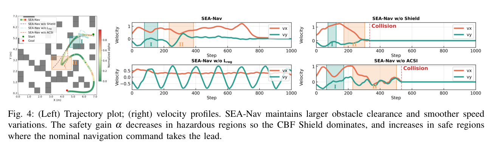
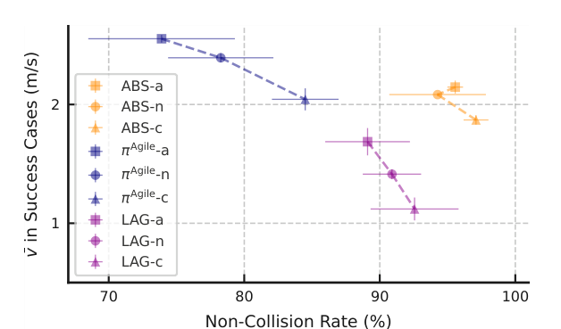
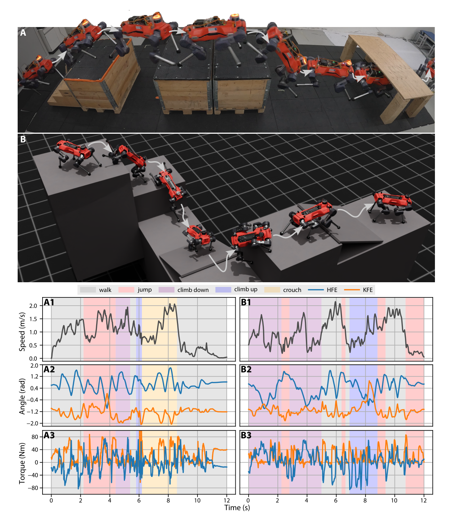
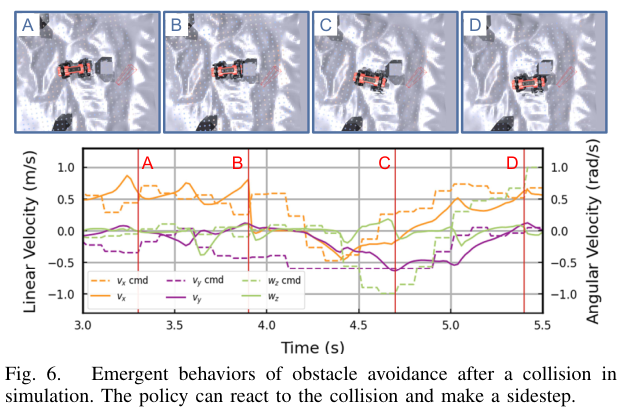
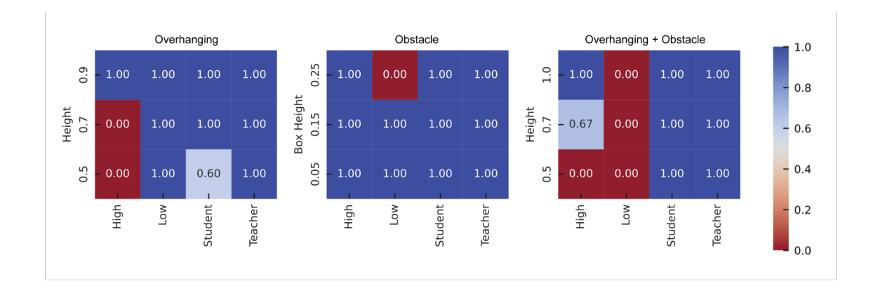
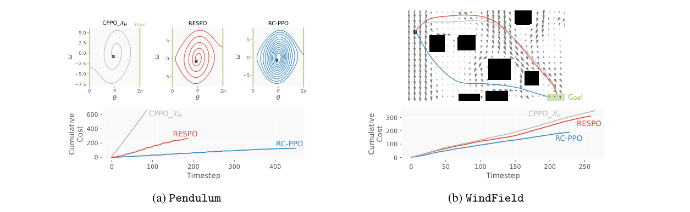

# 论文绘图参考阅读集（2026-10-20）

用途：对照 CCDC 1020 稿，检查工程贡献需要的实验结果，并学习原论文的图形表达。

已逐篇检查六篇本地原文、图注和相关实验段落，并整理了完整 PDF、文本提取、整页预览及重点图截取。这里的 PDF 从 `CORL/references` 原样复制，来源和 SHA256 见 [local_manifest.json](local_manifest.json)。这些是已有公开论文的本地副本，不能称为本次联网下载或最新版本。

本次尝试访问作者项目页、arXiv 检索和公开搜索页面。普通联网命令受沙箱限制，随后两次正式联网审批均因自动审批服务 HTTP 503 失败，命令没有执行。因此，本轮没有完成在线文献穷尽检索、版本更新核实或新 PDF 下载。下面链接来自原 PDF 的正文、超链接或 arXiv 页眉标识。

| 论文 | 核实的本地版本 | 重点图 | 最适合借鉴什么 |
| --- | --- | --- | --- |
| [SEA-Nav](papers/sea_nav.pdf) | arXiv:2603.09460v1，2026-03-10；不据此推断正式录用 | Fig. 4、Fig. 5、Table II；PDF 第 6 页 | 轨迹与速度同步；多个真机场景及定量结果 |
| [Agile But Safe](papers/abs.pdf) | arXiv:2401.17583v3，2024-05-21 | Fig. 7、Fig. 8；PDF 第 10 页 | 安全与效率权衡；轨迹、状态曲线与内部机制解释 |
| [ANYmal Parkour](papers/parkour.pdf) | 本地为 arXiv:2306.14874v1，2023-06-26；文件名中的 2024 不是所读预印本版本 | Fig. 3；PDF 第 6 页 | 真机动作与速度、关节状态、力矩在时间上的对应 |
| [Resilient Legged Local Navigation](papers/resilient.pdf) | arXiv:2310.03581v1，2023-10-05 | Fig. 6–8；PDF 第 5 页 | 事件截图、指令/实际速度、带误差条的消融 |
| [Learning to Walk in Confined Spaces](papers/confined.pdf) | arXiv:2403.00187v1，2024-02-29 | Fig. 4、Fig. 6；PDF 第 5 页 | 难度参数热图；指令和实际跟踪曲线 |
| [RC-PPO](papers/rcppo.pdf) | arXiv:2410.22600v1，NeurIPS 2024 | Fig. 4、Fig. 5；PDF 第 9 页；Fig. 6 在第 10 页 | 成本和到达率一起看；轨迹和累计成本解释行为 |

公开入口：

- SEA-Nav：https://arxiv.org/abs/2603.09460 、https://11chens.github.io/sea-nav/
- ABS：https://arxiv.org/abs/2401.17583 、https://agile-but-safe.github.io/
- ANYmal Parkour：https://arxiv.org/abs/2306.14874
- Resilient：https://arxiv.org/abs/2310.03581
- Confined Spaces：https://arxiv.org/abs/2403.00187
- RC-PPO：https://arxiv.org/abs/2410.22600 、https://oswinso.xyz/rcppo/

这些作品并不直接验证我们的方法。例如 SEA-Nav 中的 alpha 是其自适应屏障增益，与本文的成本超支边界 alpha 含义不同；Resilient 允许通过碰撞反馈恢复，与本文要求全程避障的任务语义不同。借鉴图形结构时需要保留各自的指标定义。

## 原图速览

以下图片是带出处的阅读截取，仅供分析和内部设计参考。正式论文应根据自己的系统和原始实验数据独立绘制。

### SEA-Nav：左边讲在哪里，右边讲为什么

Fig. 4，PDF 第 6 页。图中将同场景轨迹、速度曲线、碰撞时刻和屏障增益联系起来。可学习这种证据组织，不照搬其机制或数值。



### ABS：同时看效率和安全

Fig. 7，PDF 第 10 页。横轴为非碰撞率，纵轴为成功试验中的平均速度，误差条是标准差。成功条件和统计口径必须随图交代。



### ANYmal Parkour：真机行为与同步曲线

Fig. 3，PDF 第 6 页。上方动作序列与下方速度、关节角、力矩形成对应；背景色说明行为阶段。我们的对应曲线应改为执行误差、间隙和剩余预算，无需复刻大段关节力矩。



### Resilient：事件截图解释控制动作

Fig. 6，PDF 第 5 页。事件 A–D 与指令/实际速度对应。原论文 Fig. 8 的误差条表示标准差，不能统一改称 95% 置信区间。



### Confined Spaces：把运行边界画出来

Fig. 4，PDF 第 5 页。不同障碍条件下的成功率热图暴露方法的适用范围。对我们而言，可改为通道宽度、延迟或执行扰动下的 SR/CR/BVR。



### RC-PPO：轨迹与累计成本一起解释

Fig. 5，PDF 第 9 页。不同路线导致不同累计成本；图形为方法的行为解释服务。我们的图需要在此基础上明确区分名义与实际执行。



## 文件组织

```text
papers/           六篇完整原文
figures/          六组重点原图截取
previews/         整页预览与联系表
text/             完整 PDF 文本提取（带物理页码）
local_manifest.json  本地来源、哈希及原文超链接
```

渲染与归档脚本：`../../scripts/review_figure_references.py`。分析结论和绘图规格见 [审稿视角下的结果缺口与绘图建议](../../submission/1020审稿视角_结果缺口与绘图建议.md)。
