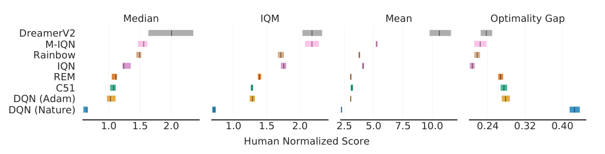
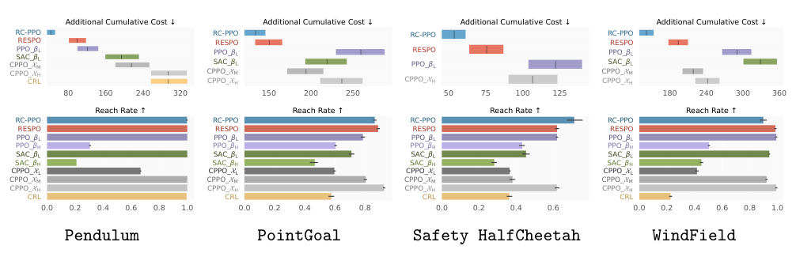
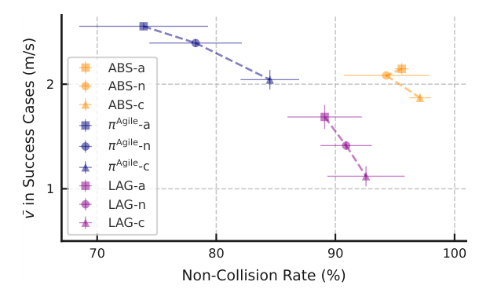
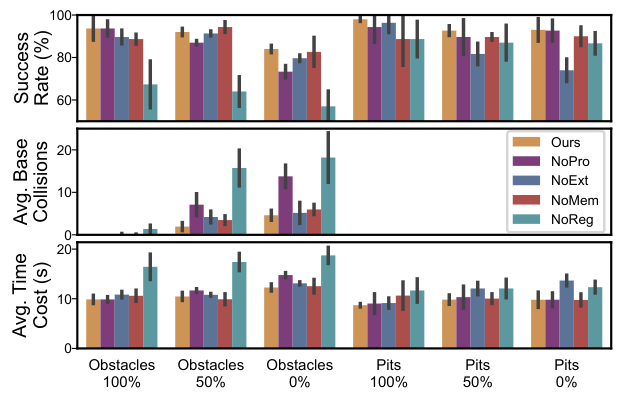
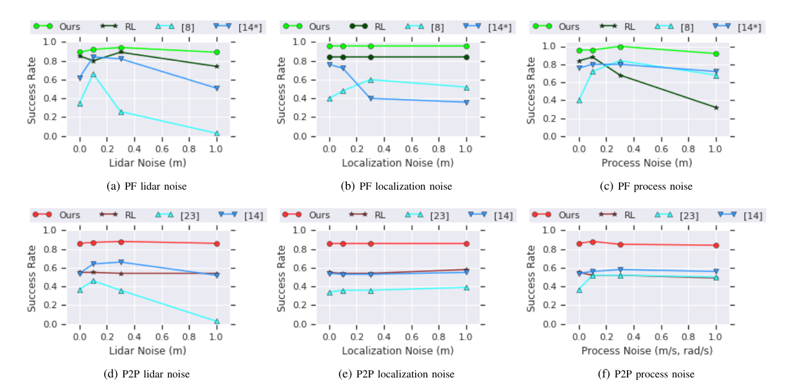
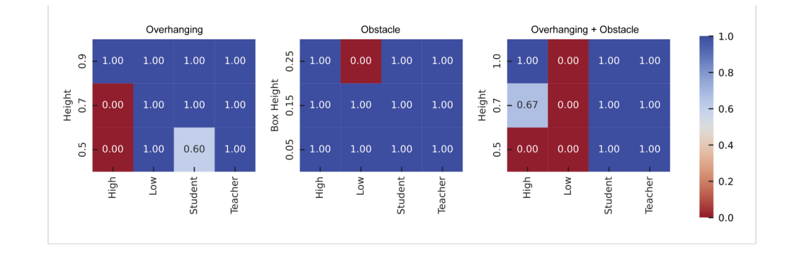
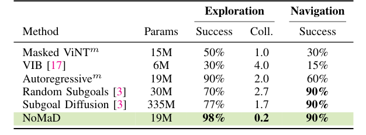

# 综合结果图：原文案例与重绘建议

日期：2026-10-22。对象：CCDC 1020 稿的 `figure_metrics_grid_single_column_v3.pdf`，不是已完成的系统总览图或轨迹同步图。

## 1. 建议

优先参考 **rliable 的横向区间点图排版**和 **RC-PPO 的方法行对齐方式**，重绘当前综合结果图。保留完整的七种方法、三个场景，用位置和轻量点标记组织信息，统一突出 HD-MCRA 与同一底层接口上的未校准 RC-PPO。优先比较 SR、CR、BVR 和执行成本，最小间隙保留在表格或几何机制结果里。

**ABS 式安全—效率散点图**是另一种值得做的表达，但它回答的是取舍关系，不能独自替代所有指标比较。若采用，应与主表分工，并根据 8 页篇幅决定是否替代原预算图的一部分。

本轮只是调研、核对和设计分析，没有生成新的实验数值，也没有重画或替换论文结果图。已有数值仍是假设占位值，下面讨论的是它们适合怎样表达。

## 2. 检索范围与证据

使用 6 组 arXiv 检索：四足导航安全、四足导航基准、风险敏感四足运动、安全强化学习基准、安全探索基准、导航成功／碰撞指标。保存了 99 条候选记录、95 个不同 URL；候选列表含不相关条目，不能当作详细阅读数量。

另对理论来源、相关导航系统及统计展示方法做定向检索。最终筛查 21 篇论文的原始 PDF、相关图注和实验页，截取其中 16 篇的 19 组原图／表。10 篇公开原文是本轮下载，其余 11 篇复用已有文件。网页元数据和下载均成功，不沿用上一轮“联网未完成”的状态。

| 论文 | 核对的结果表达 | 对本次最有用的部分 |
| --- | --- | --- |
| [Agile But Safe / ABS](https://arxiv.org/abs/2401.17583) | Fig. 7，PDF p.10；配套 Table III | 二维安全—速度权衡；图负责关系，表负责完整指标 |
| [RC-PPO](https://arxiv.org/abs/2410.22600) | Fig. 3–4，p.8–9；Fig. 6，p.10 | 横向方法比较；成本与到达率并列；超参数设置的权衡散点 |
| [rliable / Statistical Precipice](https://arxiv.org/abs/2108.13264) | Fig. 9，p.8；Fig. 7、11 相关图注 | 同行对齐、多列指标、区间估计；借鉴版式，不直接照搬 IQM 协议 |
| [Safety-Gymnasium](https://arxiv.org/abs/2310.12567) | Fig. 8、Table 2，p.9 | 分开展示任务收益与约束符合情况 |
| [Resilient Legged Local Navigation](https://arxiv.org/abs/2310.03581) | Fig. 8，p.5 | 少量消融变体的共享横轴柱状图 |
| [Learning Risk-Aware Quadrupedal Locomotion](https://arxiv.org/abs/2309.14246) | Fig. 6，p.5 | 同一风险参数下，并列展示性能、失败与跟踪误差 |
| [Risk-Aware RL with Bandit-Based Adaptation](https://arxiv.org/abs/2510.14338) | Fig. 3，p.6；Table IV | 按实际扰动类型分面，比较均值与尾部性能 |
| [AutoRL](https://arxiv.org/abs/1809.10124) | Fig. 4，p.5；Fig. 8，p.8 | 简化的场景柱状图；具有物理单位的噪声响应曲线 |
| [Learning to Walk in Confined Spaces](https://arxiv.org/abs/2403.00187) | Fig. 4，p.5 | 方法×障碍难度的热图，暴露适用边界 |
| [NoMaD](https://arxiv.org/abs/2310.07896) | Table I–II，p.5 | 多指标不必全部画成图；紧凑表格承担完整比较 |
| [SEA-Nav](https://arxiv.org/abs/2603.09460) | 归档 v1 Table I，p.5 | 以场景为列组、指标为子列；在线已有 v2，本例按 v1 解读 |
| [iPlanner](https://arxiv.org/abs/2302.11434) | Table I–II，p.5 | 多场景性能表与计算延迟表分工 |
| [ViPlanner](https://arxiv.org/abs/2310.00982) | Table II，p.5 | 以场景为行组，分清不同损失和目标到达指标 |
| [VAPOR](https://arxiv.org/abs/2309.07832) | Table I，p.6 | 多场景、成功率、耗电流和路径长度用完整表比较 |
| [ViNT](https://arxiv.org/abs/2306.14846) | Table 1–2，p.7 | 简表紧邻轨迹示例，数值与行为互补 |
| [ActSafe](https://arxiv.org/abs/2410.09486) | Fig. 4，p.9 | 收益／成本上下对应，明确约束线和训练阶段 |
| [Constrained Policy Optimization](https://arxiv.org/abs/1705.10528) | Fig. 1、3–4，p.7–8 | 收益和约束同时检查，固定惩罚权重作为直接参照 |
| Iterative Reachability Estimation / RESPO | 本地原文 Fig. 2，p.8 | 性能／安全成对的训练曲线；本次不推荐把训练曲线作为主图 |
| [OmniSafe](https://arxiv.org/abs/2305.09304) | Fig. 4，p.10；Table 3 | 多任务训练曲线与成本阈值；图很密，布局不直接照搬 |
| [ANYmal Parkour](https://arxiv.org/abs/2306.14874) | 本地 v1 Fig. 4，p.8；Fig. 3，p.6 | 难度响应曲线、动作与时序对应；对当前汇总图的直接参考较少 |
| [Robust Perceptive Locomotion](https://arxiv.org/abs/2201.08117) | 本地原文相关实验／系统页 | 强项是野外部署与感知机制展示，对当前多指标汇总图优先级较低 |

原图阅读册为 [metrics_reference_atlas.pdf](metrics_reference_atlas.pdf)。所有截取都保留了来源 PDF、物理页码、图号、裁图坐标和原始文件哈希；图中数值来自各自原论文，不是我们的方法结果。

## 3. 当前图具体为什么难读

### 3.1 图例已经小到影响印刷阅读

当前 PDF 的页面尺寸约 242.57 × 259.24 PDF pt。按 IEEEtran 单栏宽度置入后，四处 `HD-MCRA` 图例文字约 **3.3 pt**，场景名称约 **5.1 pt**。这解释了为什么在屏幕上放大还可以，放到论文里就像一团细线和小字。

应从最终印刷尺寸设计。主比较图目标字体约 8–9 pt；保留完整比较时优先用通栏。若限定单栏，应主动减少面板或方法，而不是继续缩字体。模板的字号、页边距、行距和栏宽保持不动。

### 3.2 84 根柱体和四份图例反复争夺注意力

7 种方法 × 3 个场景 × 4 个指标，共 84 根柱体。四个面板各自重复七方法图例。每个场景的七根细柱都需要在图例和图之间反复查颜色，读者很难连续比较“我们与未校准 RC-PPO”。

七种方法并不必然太多。RC-PPO 自己比较更多方法，仍通过横向方法名称、固定顺序和重复面板组织信息。问题在于当前视觉编码不适合这些维度。

### 3.3 图展示的指标与工程贡献没有完全对齐

当前四面板是 SR、CR、Average Cost、MC；成本裕度 α 最直接对应的 BVR 没有出现在这张综合图里。已有预算扫描图包含 BVR，但不足以替代跨场景的总体比较。

旧生成脚本其实已定义三个场景的 BVR 假设值，例如 HD-MCRA 为 5%、9%、13%，RC-PPO 为 8%、14%、20%。可以在核对之后用于新版版式，不需要从均值反推场景数据。

不过，**RA 的 BVR 在旧脚本按场景平均为 20%，主表却为 22%**。本轮核对了 35 个“方法×指标”组合，这一项不一致。尚未核对 Excel 工作簿或实验日志，因此这里定位的是源码和主表的差异，不能据此直接决定哪个数值正确。重绘前应统一数据源。

### 3.4 指标的方向和统计含义没有解释清楚

SR 越高越好，CR 和 BVR 越低越好；成本需要与成功／失败的计费口径一起解读。更大的间隙可能意味着更安全，也可能是过度保守绕路，不能单独当成最优目标。

当前没有逐试验散点、seed 级记录或误差统计。可以先画已有假设均值的点，但不能为了仿照参考图而补造误差棒、箱线图或置信带。

### 3.5 图与主表重复，却没有突出差异关系

现有主表给出跨场景汇总，当前图给出场景细分，二者仍有不同用途。重绘时应保留这种分工，避免再画一张完全相同的平均值图。

根据主表的假设值，我们相较 RC-PPO 的 SR 是 73.3% 对 70.7%，CR 为 15.0% 对 15.7%，成本为 88.3 对 91.7，BVR 为 9.0% 对 14.0%。应表达的是安全、效率与预算可行性的联合表现。RA 和 CPPO 的某些设置具有更低 CR，所以不宜把主图设计成“我们的每一项都是最好”的视觉暗示。

## 4. 最有参考价值的六种表达

### 4.1 横向点图／区间图：最适合重构当前综合图

**案例：rliable Fig. 9，PDF p.8。** 方法是固定的行，指标是并排的列；读者沿着一行就能检查一个方法的多项表现。图中短横条是原始试验计算出的 95% 分层 bootstrap 区间。



我们可以借鉴“方法对齐＋指标分列”，用圆点表示当前假设值。有真实记录后再加适当区间。不同指标保留各自单位和坐标，不需要归一化成一个综合分数。

不能直接照搬它的 IQM 和任务汇总协议：它覆盖数十个游戏，我们只有三个预设场景；版式适用，不意味着统计协议相同。

**补充：RC-PPO Fig. 3–4，PDF p.8–9。** 它用横向比较，并把成本与到达率放在一起，明确说明便宜是否以到不了目标为代价。Fig. 3 的误差棒为 standard error；Fig. 4 的成本是 IQM，不能统称为平均成本。



这两篇最适合作为当前主比较图的排版参考。不过 RC-PPO 原图本身也较密，我们应保留方法对齐的优点，减少小字和重复标签。

### 4.2 二维散点：最适合展示安全与效率的取舍

**案例：ABS Fig. 7，PDF p.10。** 横轴是非碰撞率，纵轴是成功回合的平均速度；一个点同时表达两种表现。误差棒是标准差。原文另有表格报告完整指标。



我们的候选表达有两种：

| 形式 | 横轴 | 纵轴 | 回答的问题 |
| --- | --- | --- | --- |
| 成本—碰撞 | 实际执行成本 | CR | 更安全是否只是走得更慢、更远、更保守？ |
| 成本—预算违规 | 实际执行成本 | BVR | 是否在更可靠守住预算的同时保持执行效率？ |

优先按三个场景分成三个小面板，避免混合不同场景的成本尺度。每种方法一个点，本文蓝色、未校准 RC-PPO 橙色，其余灰色并直接标名。尽量只编码两个量；SR 放在主表或作为预先定义的可行性标记，避免再叠加连续气泡大小。

这种图更能解释工程取舍，但不能把一次有限比较称为理论 Pareto 最优。低成本也不能由早失败获得“效率奖励”；需同时交代成功率和计费方式。

### 4.3 简化柱状图：适合少量消融，不适合继续堆七方法全指标

**案例：Resilient Fig. 8，PDF p.5。** 三个指标上下排列，共享场景横轴，只放一份图例；每个面板回答一个问题。



如果保留柱状图，建议把它用于四组受控消融：无修正、仅 α、仅 δ、两者都有。完整七方法比较留在主表或横向点图。图例一次、颜色一致、指标方向明确，误差棒来自对应试验。

原论文允许碰撞后恢复，图中的 Avg. Base Collisions 是碰撞次数，不等同于我们的 CR。应借鉴排版，而非搬用任务或指标定义。原文实验段落将该消融的不确定性表述为标准差。

AutoRL Fig. 4 与风险 bandit 论文 Fig. 3 也说明柱状图可以清晰，但关键是限制比较维度、明确每个面板的职责，而非靠渐变或更多颜色提升观感。

### 4.4 扰动／参数扫描曲线：适合证明校准的有效范围

**案例：AutoRL Fig. 8，PDF p.8。** 分别扫描 LiDAR、定位和过程噪声，横轴有物理含义；每种方法一条曲线。



我们的横轴可以是延迟（ms）、摩擦系数或跟踪扰动强度，纵轴为 SR、CR、BVR。标出校准范围后，读者能直接看到性能在哪个范围内稳定、何时开始退化。

只有实际有序的参数适合连线。三个不同类型的场景不能仅因排在一起就连成连续曲线。原图对过程噪声的单位写法也不应原样继承到我们的变量上。

风险敏感运动论文 Fig. 6 同时画收益、提前终止和速度误差，很适合借鉴多指标共用同一参数的方式；但它只有一个训练 seed，95% 区间来自 evaluation spawns，不能解释成跨训练重复的稳定性。

ActSafe Fig. 4 的收益／约束曲线有明确阈值线，值得借鉴其约束表达。其横轴是训练回合，不能用静态汇总值补画这种学习曲线；本文也无需把底层训练展开成主结果。

### 4.5 热图：适合展示适用边界

**案例：Confined Spaces Fig. 4，PDF p.5。** 方法是列、障碍参数是行，颜色与数值同时显示成功率。



如果我们后续测多个通道宽度或延迟条件，可使用“方法×条件”的单指标热图。它适合看在哪些条件下开始失效，也适合展示不同裕度的保守性边界。

当前只有三个场景的汇总值时，热图可以画得紧凑，但对 1–3 个百分点的小差异不如点图直观。不同单位的 SR、成本、间隙不要直接塞入同一个色标；二维 α／δ 热图的每个网格也需要实际数据，不能凭几个角点插值。

### 4.6 紧凑表格＋行为图：最节省篇幅的完整比较

**案例：NoMaD Table I，PDF p.5。** 方法、成功、碰撞等数据用简表直接呈现。图另行解释动作、路线和行为。



SEA-Nav、iPlanner、ViPlanner、VAPOR、ViNT 都采用了类似分工，原图见阅读册第 14–18 页。其中 ViNT 直接把定量表和路线放在一起。

对于我们，主表承担完整方法比较，已经完成的轨迹同步图解释行为，综合结果图就可以缩减为最关键的场景差异或安全—成本关系。这样能利用已有图，避免为显示全部数字再重复铺一张密集柱状图。

注意 NoMaD 的 Coll. 是平均碰撞次数，不是百分比。Safety-Gymnasium Fig. 8 的堆叠颜色对应互斥成本区间；我们的碰撞与预算违规可能同时发生，不能直接把 CR、BVR 画成加起来等于 100% 的堆叠条。

## 5. 适合我们的三个方案

### 方案 A：完整保留比较信息的横向点图（首选）

一张通栏图，横向并排四个指标面板；纵向固定七种方法，所有面板行位置相同。

```text
                   SR ↑        CR ↓        BVR ↓       Cost ↓
HD-MCRA            ○ △ □       ○ △ □       ○ △ □       ○ △ □
RC-PPO             ○ △ □       ○ △ □       ○ △ □       ○ △ □
RA                 ○ △ □       ○ △ □       ○ △ □       ○ △ □
PPO ...            ○ △ □       ○ △ □       ○ △ □       ○ △ □
CPPO ...           ○ △ □       ○ △ □       ○ △ □       ○ △ □

○：一般障碍场景；△：窄通道；□：密集障碍（只放一份图例）
```

这只是信息排布示意，符号的水平位置在正式图中由数值决定，不能按此均匀排布。

具体规则：

- HD-MCRA 蓝、RC-PPO 橙，其余方法灰；灰色方法通过所在行区分，不再为每种方法增加一种颜色。
- 每个方法内三个场景用固定点形，并沿纵向轻微错开，避免重合；所有指标使用完全相同的错开顺序，不用随机抖动。
- 不连接不同场景的点。主表报告均值，这张图保留场景差异，二者职责不同。
- 各面板独立横轴并保留原单位；点图可以在明确显示坐标的前提下使用适合数据的范围，避免沿用成本 0–300 的大量空白。
- 保留固定方法顺序，本文与 RC-PPO 相邻；不在每个指标里分别按名次排序。
- MC 不删除数据，留在主表与几何结果中。若需要对 δ 的作用做直接比较，可在消融图再展示 MC。
- 当前先显示假设点估计，后续从真实日志生成区间。图注写清样本口径，避免把占位版当作统计证据。

优点是最接近用户当前诉求：改善原图、保留全部比较信息、减轻颜色和图例负担。代价是需要通栏空间，并检查四个面板是否仍能保持约 8–9 pt 的字体。若过密，可把同一设计排为 2×2，但应适当增加实际尺寸，不能再次压回原来的单栏小字状态。

### 方案 B：主表＋三个场景的取舍散点（工程表达更强）

保留主表完整数字，综合结果图改成三个场景并排的散点：横轴成本，纵轴 BVR 或 CR。若两种违规都必须展示，可分成上下两行，但需要评估篇幅。

这个方案与已完成的轨迹同步图配合较好：散点说明总体取舍，轨迹图说明具体一次行为。它会改变原图的职责，而非仅换图形样式；应在确认新的论证分工后采用。

### 方案 C：少量方法的清爽柱状图（改动较小）

在图里只保留按比较目的预先确定的核心方法：HD-MCRA、未校准 RC-PPO，以及能代表另一种保守策略的参照。全部七种方法仍在主表中。四个指标共享一份图例，统一颜色、字号、场景顺序和留白。

这是保守的改法，但少画方法会改变图的信息范围，不能因为哪个基线不利就选择性隐藏。因此本轮优先推荐 A，再考虑 B。

## 6. 当前数据能支持什么

| 表达 | 现有假设汇总值是否足够做版式 | 正式结果还需要什么 |
| --- | --- | --- |
| 横向点图、简化柱状图 | 足够；BVR 的场景占位值在旧生成脚本中已有定义 | 统一主表／工作簿／日志的数据源 |
| 成本—CR／BVR 散点 | 同一批、同一场景的方法汇总值可先用于版式 | 同预算与计费口径，成功／失败与可行性定义 |
| 方法×场景的单指标热图 | 足够，但信息增益可能有限 | 对应场景实际统计与试验量 |
| 误差棒、CI、显著性或配对差异 | 现有均值不足 | 逐试验结果、训练 seed、配置和场景配对关系 |
| 箱线图、小提琴图、ECDF | 现有均值不足 | 原始试验分布；不能根据均值补造 |
| 扰动曲线、裕度扫描和二维网格 | 目前不能由三场景汇总替代 | 各参数设置下的对应试验，及是否重新训练的说明 |
| 训练曲线 | 静态指标不足 | 保存的训练历史与多个 seed；本文主线并不要求展开底层训练 |

现有四组消融属于另一张表的假设数据，与主结果的完整方法存在不同数值。它们可用于单独检查模块效果，不能不经说明与主结果当成同一批数据混在一张散点图里。

## 7. 重绘时的统一标准

1. 每个面板先明确要回答的问题；主图说明联合表现，消融图说明 α／δ 的不同作用，扫描图说明适用范围。
2. 按当前 CCDC 模板的实际 `\textwidth`／`\columnwidth` 出图；通栏约 181 mm、单栏约 89 mm。以最终插入尺寸检查字体，不改模板来迁就图片。
3. 本文蓝、RC-PPO 橙、其他参照低饱和灰；颜色同时配合点形和文字，保证灰度下可区分。
4. 一张图只放必要图例，优先直接写方法名称；减少粗边框、大段标题、装饰性阴影和渐变。
5. 所有指标保留独立单位，不做缺乏含义的混合归一化或雷达面积比较。
6. SR 差异用百分点表述；成本比较写清成功条件与失败计费；更大间隙的代价也要可见。
7. 不同来源的不确定性分别标明 SD、SE、CI 及统计单位。借鉴的是图形组织，不是把别人的误差定义搬成我们的。
8. 完整结果表与图形成分工，控制总篇幅；不必把本轮 19 个案例都变成论文里的新图。

## 8. 原图导航

| 阅读册页 | 案例与原文位置 | 截图 |
| --- | --- | --- |
| 1 | ABS Fig. 7，原文 p.10 | [安全—效率](figures/01_abs_tradeoff.png) |
| 2 | RC-PPO Fig. 3，p.8 | [横向方法比较](figures/02_rcppo_horizontal_bars.png) |
| 3 | RC-PPO Fig. 4，p.9 | [成本＋到达率](figures/03_rcppo_cost_reach.png) |
| 4 | RC-PPO Fig. 6，p.10 | [测试设置的权衡](figures/04_rcppo_tradeoff.png) |
| 5 | rliable Fig. 9，p.8 | [横向区间图](figures/05_rliable_interval_points.png) |
| 6 | Safety-Gymnasium Fig. 8，p.9 | [性能与约束分类](figures/06_safety_gymnasium_summary.png) |
| 7 | Resilient Fig. 8，p.5 | [消融柱状图](figures/07_resilient_ablation.png) |
| 8 | Risk-Aware Distributional RL Fig. 6，p.5 | [参数响应](figures/08_distributional_sensitivity.png) |
| 9 | Risk-Aware Bandit RL Fig. 3，p.6 | [均值／尾部与扰动](figures/09_bandit_robustness_bars.png) |
| 10 | AutoRL Fig. 4，p.5 | [简化场景柱状图](figures/10_autorl_simple_bars.png) |
| 11 | AutoRL Fig. 8，p.8 | [噪声扫描](figures/11_autorl_noise_sweep.png) |
| 12 | Confined Spaces Fig. 4，p.5 | [运行边界热图](figures/12_confined_heatmap.png) |
| 13 | NoMaD Table I，p.5 | [紧凑综合表](figures/13_nomad_compact_table.png) |
| 14 | SEA-Nav v1 Table I，p.5 | [场景列组](figures/14_seanav_scene_table.png) |
| 15 | iPlanner Table I，p.5 | [多场景简表](figures/15_iplanner_scene_table.png) |
| 16 | ViPlanner Table II，p.5 | [场景行组](figures/16_viplanner_metrics_table.png) |
| 17 | VAPOR Table I，p.6 | [多指标完整表](figures/17_vapor_metrics_table.png) |
| 18 | ViNT Table 1，p.7 上方 | [简表＋路线](figures/18_vint_table_trajectory.png) |
| 19 | ActSafe Fig. 4，p.9 | [学习性能与约束线](figures/19_actsafe_constraint_curves.png) |
