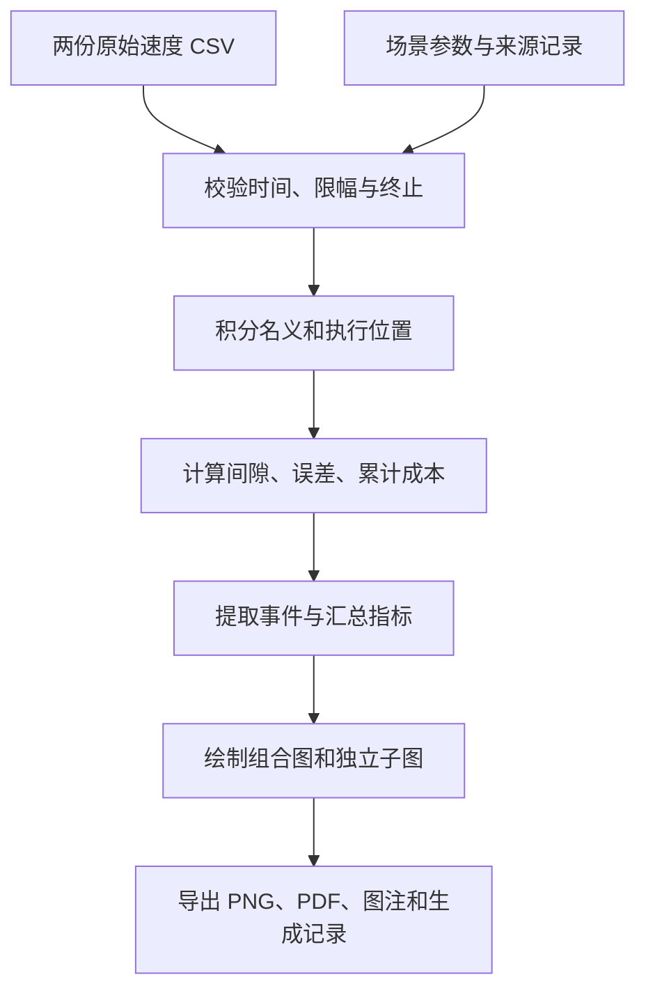

# 轨迹与同步曲线：图表说明与使用手册

更新日期：2026-10-21。适用范围：当前两方法、同场景轨迹与三排同步曲线的绘制、维护及论文写作。

这份手册回答四个问题：图中每一部分表达什么；数据从哪里来、怎样计算；以后怎样换数据和改图；写论文时可以据此说明什么。

**当前推荐版本：原始数据 v2，论文版式 publication_v4_final。当前数值仍是逐点编写的假设数据，图面采用论文版式不代表已经获得真实实验结果。**

## 1. 先找到需要的文件

项目根目录：[20261021_轨迹与同步曲线](C:/Users/smile/Desktop/paper/绘图/20261021_轨迹与同步曲线)。以下表格是常用入口。

| 要做什么 | 打开哪里 |
| --- | --- |
| 看当前组合图 | [PNG](C:/Users/smile/Desktop/paper/绘图/20261021_轨迹与同步曲线/output/publication_v4_final/trajectory_sync.png) |
| 获取论文插图文件 | [矢量 PDF](C:/Users/smile/Desktop/paper/绘图/20261021_轨迹与同步曲线/output/publication_v4_final/trajectory_sync.pdf) |
| 看中英文图注与当前数据说明 | [caption.md](C:/Users/smile/Desktop/paper/绘图/20261021_轨迹与同步曲线/output/publication_v4_final/caption.md) |
| 找两种方法的原始数据 | [data/versions/v2](C:/Users/smile/Desktop/paper/绘图/20261021_轨迹与同步曲线/data/versions/v2) |
| 找绘图与计算代码 | [scripts](C:/Users/smile/Desktop/paper/绘图/20261021_轨迹与同步曲线/scripts) |
| 找四张独立子图 | [panels](C:/Users/smile/Desktop/paper/绘图/20261021_轨迹与同步曲线/output/publication_v4_final/panels) |
| 看计算与数据审查 | [data_audit_v2.md](C:/Users/smile/Desktop/paper/绘图/20261021_轨迹与同步曲线/output/data_audit_v2.md) |
| 看此次版式调整及验收 | [revision_review.md](C:/Users/smile/Desktop/paper/绘图/20261021_轨迹与同步曲线/output/publication_v4_final/revision_review.md) |


第一次阅读可按第 2—7 节理解图与数据；直接操作可跳到 [重新生成图片](#8-怎样重新生成图片)、[修改位置对照](#9-后面想改什么应该改哪里)、[真实日志适配](#10-接入真实机器人日志前要对齐的内容)、[论文写作](#11-后续作图与论文写作怎么使用) 或 [问题排查](#12-常见问题与排查)。

## 2. 这张图要解释什么

论文的工程主线是：把 RC-PPO/MCRA 用到四足机器人上，通过固定低层速度跟踪接口，使高层面对一个相对稳定的闭环系统，再用执行数据中的成本与轨迹偏差标定 α、δ。底层强化学习控制器在这条主线里是接口基础。

本图将“同场景中怎样走”和“沿途发生了什么”放在一起。读者可以从空间位置找到对应时刻，检查机器人靠障碍有多近、累计成本有多少，以及速度指令执行得怎样。

| 论文中的问题 | 本图对应内容 | 本图承担的说明作用 |
| --- | --- | --- |
| 高层指令经过低层执行后产生误差 | 名义/执行路线、右下跟踪误差 | 展示同一类速度接口下仍存在执行偏差 |
| 名义成本与执行成本不同 | 右中名义成本、执行成本、校正计费和预算 | 解释 α 如何增加名义计费余量 |
| 名义路线与执行路线不同 | 灰色扩张区、局部足迹、右上间隙 | 解释 δ 额外空间余量的几何含义 |
| 安全裕量会带来代价 | 左下耗时与间隙、右中累计成本 | 同时展示安全、时间、成本之间的取舍 |

当前并没有运行两种策略来生成路线，因此这些是机制说明关系，不能当作已验证的因果效果。证明真实部署有效，还要使用实际日志、校准分布、模块消融和多次实验统计。

## 3. 逐部分读图

### 3.1 颜色、线型与坐标

| 图形元素 | 含义 |
| --- | --- |
| 蓝色 `#0072B2` | HD-MCRA，即我们的方法 |
| 橙色 `#D55E00` | 未校准的 RC-PPO 对照配置 |
| 彩色实线 | 路线图中的执行路径，或成本图中的执行累计成本 |
| 同色浅虚线 | 名义路径或名义累计成本；在当前示例中来自相同命令的理想跟踪 |
| 蓝色点划线 | 校正名义计费 `(1+α)J_nom`，不是又一条实际成本曲线 |
| 成本图中的浅蓝填充 | 名义成本到校正计费之间预留的差额；不是置信区间 |
| A/B 与同色竖虚线 | 每种方法各自经过检查位置的事件与时刻 |
| 路线坐标 x、y | 世界坐标中的位置，单位 m |
| 右侧横坐标 | 从各自试验起点开始的经过时间，单位 s |

### 3.2 左上 (a)：同场景路线

Start 是共同起点；绿色星号是目标中心，绿色区域是允许到达的目标范围。轨迹进入目标范围即判定到达，所以彩色线不一定走到星号中心才结束。

深灰圆 O1/O2/O3 是实体障碍。浅灰圆是在实体障碍外加上机器人半径后得到的区域，方便用机器人中心路径判断身体是否碰到障碍。最外侧灰色点线再加上 HD-MCRA 的 δ 规划余量。

三个半径依次为：`障碍半径`、`障碍半径 + 机器人半径`、`障碍半径 + 机器人半径 + δ`。浅灰圈已经计入身体尺寸，δ 表示额外执行余量，二者不应重复计算。

彩色路线表示机器人中心的位置，不是脚尖轨迹，也不是完整步态。比较实线与该方法自己的浅虚线，可以看出名义和执行位置的偏离；比较蓝橙实线，可以看出两种配置选择的路线不同。

### 3.3 左下：A 点足迹与关键数字

局部图放大两种方法各自经过 A 时的情况，蓝色和橙色圆圈代表机器人身体的圆形近似。它们位于同一个场景中的不同时间，并不是两台机器人同时行走。

`Minimum clearance` 是全程采样点中最小的身体净间隙，不只是 A 点的间隙。`Arrival time` 是当前成功样例首次进入目标区的时间。蓝橙数值的对应关系沿用顶部方法图例。

当前蓝色净间隙约 14.7 cm，橙色约 2.8 cm；蓝色耗时 14.8 s，橙色 13.2 s。它说明当前示例中更大的安全空间伴随更长耗时，不意味着所有场景都如此。

### 3.4 右上 (b)：身体间隙

纵轴是机器人身体外缘到最近实体障碍边缘的净距离。越接近零，越接近接触；零表示接触边界，负值表示发生几何侵入。

间隙按实体障碍与身体计算，公式不再减 δ。所以 `δ=0.12 m` 不等于实际最小间隙一定为 `0.12 m`，也不能把图中的间隙简单理解为“剩余 δ”。

当前橙色曲线在第一处窄间隙附近更接近零，蓝色曲线的全程最小值更高。各时刻最近的障碍可能变化，因此曲线局部折弯不一定对应动作突变。

### 3.5 右中 (c)：累计成本、校正计费与预算

实际成本 `J_exec` 是按当前示例成本函数沿执行过程累加的值；名义成本 `J_nom` 是沿名义过程计算的值。两条线很接近时，浅虚线可能被实线部分遮住。

HD-MCRA 的内部计费为 `J_charged=(1+α)J_nom`，当前 α=0.18。它表示名义成本按 1.18 倍计入预算，预留执行超支余量；不是把实际成本减少了 18%，也不是证明实际成本恰好增加 18%。

灰色水平线是共同初始预算 85。判断实际预算违规，应比较 `J_exec` 与 85；内部剩余预算则由 `85-J_charged` 得到。当前图显示累计量和预算上限，没有单独画剩余预算曲线。

当前两方法都未超预算，蓝色最终实际成本略高。因此这部分可以说明预算计费关系，不能单凭本例证明 α 防止了违规。

### 3.6 右下 (d)：线速度跟踪误差

纵轴是实际平面速度与指令平面速度之差的欧氏范数，单位 m/s。越小表示该时间区间内速度越接近指令。它不是位置误差，也不是累计误差；角速度误差另存于派生数据，没有画在这个面板中。

蓝橙曲线交替高低，符合共享低层速度接口的比较设定。当前蓝色全程 RMSE 还略高于橙色，因此不应把这张图解释成“我们训练出了更好的低层跟踪器”。

### 3.7 A/B 如何把左右图连起来

事件定义是执行位置第一次满足 A：`x≥1.9 m`，B：`x≥3.3 m` 的采样点。事件不是自动寻找的全程最危险点，也没有通过插值生成一个“恰好穿过”的新观测。

| 事件 | RC-PPO | HD-MCRA |
| --- | ---: | ---: |
| A 首次采样通过 | 6.0 s | 6.8 s |
| B 首次采样通过 | 10.0 s | 11.2 s |

地图标记与右侧竖线来自同一份 `events.csv`，所以能对应“这个位置”和“这个时刻”。不同方法通过同一检查位置的时间不必一致。

## 4. 当前数据怎么得到的

本次先固定场景、采样间隔、预算、成本定义和终止规则，再依据起步、绕障、转向与收敛阶段，逐点编写指令和执行速度。编写时考虑多个历史时刻与整个运动阶段的连贯性；两种方法分别设计，未把一条曲线简单缩放成另一条。

原始数据没有由随机噪声、统一曲线公式或插值脚本批量生成。绘图脚本只读取已经写入 CSV 的数值，计算派生指标并绘制。曲线上的细微不规则变化仍是人工假设，不是传感器噪声测量。

为避免位置、速度、间隙、成本彼此矛盾，本次只把速度记录作为原始运动依据；位置由积分得到，其他量再从位置和速度计算。



早期审查曾发现转弯过早、首次到达后还有多余记录、速度精度造成误差幅值重复等问题。保留旧版本后逐点修正，当前以 v2 为准。查看完整历史可打开 [revision_notes.md](C:/Users/smile/Desktop/paper/绘图/20261021_轨迹与同步曲线/data/versions/v2/revision_notes.md)。

## 5. 数据位置、字段与版本

### 5.1 哪些是输入，哪些是输出

| 文件或目录 | 作用 | 通常怎样维护 |
| --- | --- | --- |
| [raw_rcppo.csv](C:/Users/smile/Desktop/paper/绘图/20261021_轨迹与同步曲线/data/versions/v2/raw_rcppo.csv) | RC-PPO 的 66 条原始区间记录 | 换数据时在新版本中替换 |
| [raw_hd_mcra.csv](C:/Users/smile/Desktop/paper/绘图/20261021_轨迹与同步曲线/data/versions/v2/raw_hd_mcra.csv) | HD-MCRA 的 74 条原始区间记录 | 换数据时在新版本中替换 |
| [scenario.json](C:/Users/smile/Desktop/paper/绘图/20261021_轨迹与同步曲线/data/versions/v2/scenario.json) | 几何、时间、预算、成本与方法参数 | 按新实验配置调整 |
| [metadata.json](C:/Users/smile/Desktop/paper/绘图/20261021_轨迹与同步曲线/data/versions/v2/metadata.json) | 数据性质、试验标识和来源 | 与实际来源同步维护 |
| [derived_rcppo.csv](C:/Users/smile/Desktop/paper/绘图/20261021_轨迹与同步曲线/data/versions/v2/derived_rcppo.csv)、[derived_hd_mcra.csv](C:/Users/smile/Desktop/paper/绘图/20261021_轨迹与同步曲线/data/versions/v2/derived_hd_mcra.csv) | 积分位置、间隙、成本、误差等 | 由脚本重算 |
| [events.csv](C:/Users/smile/Desktop/paper/绘图/20261021_轨迹与同步曲线/data/versions/v2/events.csv) | A/B 时刻及对应位置 | 由脚本提取 |
| [summary.json](C:/Users/smile/Desktop/paper/绘图/20261021_轨迹与同步曲线/data/versions/v2/summary.json) | 耗时、最小间隙、终值和 RMSE | 由脚本汇总 |
| [schema.md](C:/Users/smile/Desktop/paper/绘图/20261021_轨迹与同步曲线/data/versions/v2/schema.md)、[protocol.md](C:/Users/smile/Desktop/paper/绘图/20261021_轨迹与同步曲线/data/versions/v2/protocol.md) | 原始字段与计算约定 | 改协议时在新版本同步更新 |

`v2` 中的派生文件是已验收快照。最新重绘入口会重新读取两份原始 CSV，并在新的输出目录内生成 `data` 子目录；它不会靠手动修改快照中的 `derived_*.csv` 来更新图。

输出目录中的 `data` 保存配置、元信息和派生数据，不复制两份原始 CSV。归档时要同时保留源数据目录，不能只保存输出目录。

### 5.2 原始 CSV 的七列

列名和顺序固定如下：

```csv
t_s,v_cmd_x_mps,v_cmd_y_mps,yaw_rate_cmd_radps,v_exec_x_mps,v_exec_y_mps,yaw_rate_exec_radps
```

| 列名 | 含义 | 单位 |
| --- | --- | --- |
| `t_s` | 该运动区间的起始时刻 | s |
| `v_cmd_x_mps` | 机身坐标系 x 方向指令速度 | m/s |
| `v_cmd_y_mps` | 机身坐标系 y 方向指令速度 | m/s |
| `yaw_rate_cmd_radps` | 指令偏航角速度 | rad/s |
| `v_exec_x_mps` | 机身坐标系 x 方向执行速度 | m/s |
| `v_exec_y_mps` | 机身坐标系 y 方向执行速度 | m/s |
| `yaw_rate_exec_radps` | 执行偏航角速度 | rad/s |

文件使用 UTF-8、逗号分隔、小数点为英文点。七列均应为有限数值；原始记录不能含空值、NaN 或单位文字。

每行代表 `[t,t+dt)` 区间的速度，当前 `dt=0.2 s`。时间必须从 0 开始严格按该步长排列。当前 yaw 与偏航角速度均为 0，但允许 y 方向平移，所以路线可以转弯，机身无需跟着转头；这不是差速车模型或真实步态仿真。

例如 HD-MCRA 的第一行原始记录为：

```csv
0.0,0.15,-0.03,0,0.123,-0.014,0
```

它表示第一个 0.2 s 区间：指令速度为 `(0.15,-0.03)`，执行速度为 `(0.123,-0.014)`。从原点出发，下一名义位置为 `(0.030,-0.006)` m，执行位置为 `(0.0246,-0.0028)` m；该区间线速度误差约为 `0.03138 m/s`。这些是当前假设记录的计算示例。

### 5.3 为什么原始数据与曲线终点行数不同

N 行原始速度描述 N 个区间，积分后有 N+1 行状态，包括初始状态和最终状态。

| 方法 | 原始区间数 | 原始最后时刻 | 派生状态数 | 最终状态时刻 |
| --- | ---: | ---: | ---: | ---: |
| RC-PPO | 66 | 13.0 s | 67 | 13.2 s |
| HD-MCRA | 74 | 14.6 s | 75 | 14.8 s |

最终状态没有下一条动作记录，因此最终行的误差和区间增量为空；累计成本与位置仍有效。右下误差曲线分别绘到 13.0 s、14.6 s，其他状态曲线绘到 13.2 s、14.8 s。这不是漏数据，不应补一条零误差来凑齐端点。

### 5.4 派生字段速查

| 字段组 | 用处 |
| --- | --- |
| `x_nom_m, y_nom_m, yaw_nom_rad` | 名义轨迹 |
| `x_exec_m, y_exec_m, yaw_exec_rad` | 执行轨迹 |
| `clearance_nom_m, clearance_exec_m` | 名义/执行身体净间隙 |
| `path_deviation_m` | 同一方法同时刻名义与执行位置的距离 |
| `tracking_error_mps, yaw_error_radps` | 线速度误差与角速度误差 |
| `cost_nom_step, cost_exec_step, cost_charged_step` | 本区间的名义、执行和校正计费增量 |
| `J_nom, J_exec, J_charged` | 截至当前时刻的对应累计值 |
| `z_internal, z_actual` | 内部剩余预算与按执行成本计算的剩余预算 |
| `budget_violation, terminal` | 是否超预算、是否到达/碰撞/超时 |

`events.csv` 中的 `sample_index` 是零起始状态索引；`trial_id` 当前由 `scenario_id + 方法标识` 生成，不会直接从 metadata 中读取任意试验编号。接入真实 trial ID 时应同步适配这处逻辑。

### 5.5 不要混淆数据版与排版版

| 名称 | 当前含义 |
| --- | --- |
| `data/versions/v1` | 第一轮冻结数据，保留追溯 |
| `data/versions/v2` | 当前权威输入数据 |
| `output/final` | 旧版 v3 图面，带图内说明 |
| `output/publication_v4` | 本次简化版式的第一轮输出 |
| `output/publication_v4_final` | 已检查的当前论文图版式 |
| `output/final_manifest.json` | 旧交付时的清单，不能当作后来修改文件的最新哈希 |

`schema_version=1.0` 表示字段结构版本，不等于数据快照必须叫 v1。以后改数据和改排版可以分别编号，交付时记录二者的组合。

## 6. 数值怎样计算，以及当前场景参数

### 6.1 场景与预算

| 配置 | 当前值 |
| --- | --- |
| 初始位姿 | `(x,y,yaw)=(0,0,0)` |
| 目标中心与半径 | `(4.6,0)` m；0.20 m |
| 机器人圆形足迹半径 | 0.20 m |
| 步长与最长时限 | 0.2 s；30 s |
| 初始预算 | 两方法均为 85 示例成本单位 |
| HD-MCRA 参数 | α=0.18；δ=0.12 m |
| RC-PPO 参数 | α=0；δ=0 |
| 指令绝对值上限 | vx 0.6 m/s、vy 0.4 m/s、偏航角速度 1.2 rad/s |
| 执行速度/加速度筛查 | 线速度 0.8 m/s、线加速度 1.8 m/s²、角加速度 4 rad/s² |

| 障碍物 | 中心坐标 / m | 实体半径 / m |
| --- | --- | ---: |
| O1 | `(1.9,0.38)` | 0.38 |
| O2 | `(3.3,-0.7)` | 0.40 |
| O3 | `(3.7,1.1)` | 0.30 |

这些限值与圆形近似是当前示例协议。通过筛查只说明记录符合该协议，不能替代真实四足机器人的动力学可行性验证。

### 6.2 从速度到位置

设机身速度为 `(vx,vy)`、当前航向为 `θ`，每步采用区间起始航向旋转到世界坐标后显式积分：

```text
x_next = x + dt × (cosθ × vx - sinθ × vy)
y_next = y + dt × (sinθ × vx + cosθ × vy)
θ_next = θ + dt × yaw_rate
```

名义状态用指令速度推进，执行状态用执行速度推进，二者分别维护自己的航向。本例的“名义模型”就是理想跟踪积分，不是已经辨识出的论文闭环动力学模型。

### 6.3 间隙、偏差与误差

```text
身体净间隙 = min_i(机器人中心到障碍 i 中心的距离 - 障碍 i 半径 - 机器人半径)
位置偏差   = ||执行位置 - 名义位置||₂
线速度误差 = ||执行平面速度 - 指令平面速度||₂
跟踪 RMSE  = sqrt(mean(线速度误差²))
```

图中最小间隙来自采样状态。独立审查还计算每一相邻状态间直线段的圆形足迹扫掠间隙，用于避免采样点安全但中间穿障。RC-PPO 的采样最小值约 0.02758 m，扫掠最小值约 0.02687 m；论文表述应说明采用哪一种定义。

### 6.4 成本与 α 计费

当前采用以下示例成本率：

```text
rate = 3.6
     + 3 × ||v||₂²
     + 20 × ||v - v_cmd||₂²
     + 2 × max(0, 0.45 - clearance)
区间成本 = rate × dt
```

四项分别表示随时间累积的基础代价、速度代价、跟踪误差代价与靠近障碍的代价。名义计算使用名义状态和指令速度，其跟踪误差项为零；执行计算使用执行状态和执行速度。成本按区间起点状态计算，再累加到下一状态时刻。

```text
J_charged = (1 + α) × J_nom
z_internal = initial_budget - J_charged
z_actual   = initial_budget - J_exec
实际违规条件：J_exec > initial_budget（实现中留有 1e-8 的数值容差）
相对成本超支 = J_exec / J_nom - 1
```

这套成本是便于解释时间、运动、跟踪和近障关系的代理函数，不是已经核实的论文成本，也不是焦耳。`Cost (a.u.)` 表示示例单位。仅把轴标签改成 J 不会将计算变成能耗。

### 6.5 终止规则

每个区间末依次检查扫掠碰撞、进入目标区、到达时限。当前样例在各自首次到达处结束，没有补停留尾段。预算违规只记录，不提前终止这条诊断轨迹。

当前碰撞/目标/超时顺序和预算不终止行为写在计算代码中；配置中的相关字段用于说明协议，不能认为只改配置就会切换全部终止逻辑。

## 7. 当前结果与可解释范围

下表来自冻结 v2 汇总，全部为假设数据；成本单位沿用第 6 节。

| 指标 | RC-PPO | HD-MCRA |
| --- | ---: | ---: |
| 首次到达时间 / s | 13.2 | 14.8 |
| 路径长度 / m | 4.47744 | 4.61218 |
| 采样最小身体间隙 / m | 0.02758 | 0.14656 |
| 最大名义/执行位置偏差 / m | 0.07996 | 0.04010 |
| 线速度跟踪 RMSE / (m/s) | 0.02674 | 0.02803 |
| 名义累计成本 | 56.68669 | 61.26616 |
| 执行累计成本 | 56.90846 | 61.59031 |
| 内部校正计费 | 56.68669 | 72.29407 |
| 相对成本超支 | 约 0.391% | 约 0.529% |
| 初始预算 | 85 | 85 |
| 实际是否超预算 | 否 | 否 |

这是一组“更大空间余量，稍长路径、时间与更高成本”的案例，不是各项都更好的案例。α=0.18 来自此前稿件的假设校准设定，不由本例约 0.4%—0.5% 的单次成本差异反推出。

α、δ 对应的是预留规则；单次偏差、单次最小间隙、总体校准分位数是不同统计量。若以后要展示分位数覆盖，应使用独立的校准与验证记录，而不是要求本图端点等于分位数。

## 8. 怎样重新生成图片

### 8.1 使用已经安装好的环境

绘图使用本机 Conda 的 `py39` 环境，不需要训练策略，也不需要连接机器人。

| 项目 | 当前环境 |
| --- | --- |
| Conda 程序 | `D:/codesoftware/Miniconda/Scripts/conda.exe` |
| 绘图 Python | `D:/codesoftware/Miniconda/envs/py39/python.exe` |
| 主要依赖 | Python 3.9.21、NumPy 1.26.0、Pandas 2.2.3、Matplotlib 3.9.4、Pillow 11.2.1；原环境另有 SciPy 1.13.1 |
| PDF 结构检查 | 现有 base Python 的 PyMuPDF：`D:/codesoftware/Miniconda/python.exe` |
| PDF 渲染检查 | 已安装的 Poppler `pdftoppm` |

### 8.2 一条命令重绘当前数据

在 PowerShell 中运行下面的完整命令。示例使用全路径，不依赖终端当前目录；反引号是 PowerShell 的换行符，反引号后不要添加空格。

```powershell
& 'D:/codesoftware/Miniconda/Scripts/conda.exe' run -n py39 --no-capture-output python -B `
  'C:/Users/smile/Desktop/paper/绘图/20261021_轨迹与同步曲线/scripts/render_publication.py' `
  --data-dir 'C:/Users/smile/Desktop/paper/绘图/20261021_轨迹与同步曲线/data/versions/v2' `
  --output-dir 'C:/Users/smile/Desktop/paper/绘图/20261021_轨迹与同步曲线/output/publication_rebuild_01'
```

`--data-dir` 指定原始输入；`--output-dir` 指定新输出目录。输出目录必须尚不存在；第二次运行时可改为 `publication_rebuild_02`。保留历史目录便于核对，不需要先删旧图。

命令会校验原始记录、重算派生量、绘制五张图、写出图注并记录哈希。它不会运行策略、训练控制器或生成原始运动数据，也不会自动把图插入论文。

**请使用 `render_publication.py` 作为当前入口。** 直接运行 `compose_figure.py`、`plot_metrics.py` 或 `plot_trajectory.py` 的命令行入口，默认仍走保留的旧版绘图路径，可能出现已经移走的图内说明。

### 8.3 新输出目录里有什么

| 输出项 | 用途 |
| --- | --- |
| `trajectory_sync.png` | 300 dpi 组合图预览 |
| `trajectory_sync.pdf` | 184.2 × 90 mm 的矢量组合图 |
| `panels/trajectory.png` 与 `.pdf` | 独立主路线图；不包含组合图中的局部放大和左下统计块 |
| `panels/clearance.png` 与 `.pdf` | 独立间隙曲线 |
| `panels/cost.png` 与 `.pdf` | 独立成本与预算曲线 |
| `panels/tracking.png` 与 `.pdf` | 独立速度跟踪误差曲线 |
| `caption.md` | 本次输入对应的中英文图注、参数和数据性质说明 |
| `data/` | 本次重算的派生数据、事件、汇总及配置副本 |
| `render_report.json` | 输入路径、输入哈希、输出哈希与计算校验结果 |

组合图是在同一个 Matplotlib 画布上直接排版，不是把几张 PNG 截图拼起来，因此 PDF 中的线条与文字保持矢量形式。独立子图和组合图共用绘制函数，但标题、留白与图例根据画布分别布局。

`render_report.json` 中 `source_unchanged=true` 表示生成前后原始输入未变；`existing_derived_byte_equal` 表示与输入目录中已有派生快照的比较。新版本若没有旧派生快照，该字段可以为空；修改了原始数据却带着旧派生文件，则比较可能为 false，应确认版本来源，不应改报告来消除差异。

`pdf_qa.json`、`pdf_render.png` 与人工审查文档来自另外的检查步骤，不会由上述重绘入口自动生成。

### 8.4 检查新导出的 PDF

假设上一条命令成功生成 `publication_rebuild_01`，可用现有 base Python 检查这五份 PDF：

```powershell
& 'D:/codesoftware/Miniconda/python.exe' -B `
  'C:/Users/smile/Desktop/paper/绘图/20261021_轨迹与同步曲线/scripts/inspect_publication.py' `
  'C:/Users/smile/Desktop/paper/绘图/20261021_轨迹与同步曲线/output/publication_rebuild_01'
```

检查会写出 `pdf_qa.json`，核对页数、组合图宽度、矢量对象、越界文字、子图编号和数据状态元信息。它检查的是当前论文版式约定，不是对实验数据真实性的认证，也不能替代目视检查文字重叠。

进一步将组合 PDF 渲染成图片：

```powershell
& 'C:/Users/smile/.cache/codex-runtimes/codex-primary-runtime/dependencies/native/poppler/Library/bin/pdftoppm.exe' `
  -scale-to 2200 -singlefile -png `
  'C:/Users/smile/Desktop/paper/绘图/20261021_轨迹与同步曲线/output/publication_rebuild_01/trajectory_sync.pdf' `
  'C:/Users/smile/Desktop/paper/绘图/20261021_轨迹与同步曲线/output/publication_rebuild_01/pdf_render'
```

随后打开新生成的 `pdf_render.png` 和论文中实际缩放后的图，核对标题、图例、事件、刻度与公式。当前版式的轴范围会适配数据，但新的数值数量级或事件挤在一起时，仍需检查局部排版。

### 8.5 只核对当前数据，或修改计算后运行检查

下面的命令核对 v2 原始记录与冻结派生文件，并写出一个单独报告：

```powershell
& 'D:/codesoftware/Miniconda/Scripts/conda.exe' run -n py39 --no-capture-output python -B `
  'C:/Users/smile/Desktop/paper/绘图/20261021_轨迹与同步曲线/scripts/validate_data.py' `
  --data-dir 'C:/Users/smile/Desktop/paper/绘图/20261021_轨迹与同步曲线/data/versions/v2' `
  --report 'C:/Users/smile/Desktop/paper/绘图/20261021_轨迹与同步曲线/output/manual_validation_v2_01.json'
```

该独立校验脚本的报告头仍固定写着 `data_status=assumed`，适用于当前样例。以后接入真实数据，需同步维护此处元信息；当前重绘入口中的图注、PDF 元信息及生成报告则读取场景的 `data_status`。

若修改了积分、成本、扫掠距离或终止逻辑，运行已有计算测试：

```powershell
& 'D:/codesoftware/Miniconda/Scripts/conda.exe' run -n py39 --no-capture-output python -B `
  'C:/Users/smile/Desktop/paper/绘图/20261021_轨迹与同步曲线/scripts/test_metrics.py'
```

当前 7 项测试覆盖已知位移/旋转、扫掠几何、成本与预算边界、时间及终止记录、误差单位、缺失/错误派生数据与加速度检查。仅改文档或图中文字时，不必重复计算测试；改计算定义后，还需核对测试中的旧协议是否仍适用。

## 9. 后面想改什么，应该改哪里

### 9.1 修改位置对照表

以下脚本均在 [scripts](C:/Users/smile/Desktop/paper/绘图/20261021_轨迹与同步曲线/scripts) 中。优先修改论文版式函数或 `publication=True` 分支；旧分支用于保留历史输出。

| 要修改的内容 | 修改位置 | 改完后会发生什么 |
| --- | --- | --- |
| 指令与实际速度记录 | 新版本中的两份 `raw_*.csv` | 重新计算路线、误差、间隙、成本、事件和汇总 |
| 起点、目标、障碍位置与半径 | 新版本 `scenario.json` | 更新几何、积分起点、间隙和终止检查 |
| 机器人圆形尺寸 | `robot_radius_m` | 更新足迹、几何间隙、碰撞检查与局部图 |
| 初始预算 | `initial_budget` | 更新预算线、文字、余额与违规判断 |
| α | `methods.hd_mcra.alpha` | 更新校正计费、内部余额与图注；既定路线不变 |
| δ | `methods.hd_mcra.delta_m` | 更新额外边界、名义间隙校验与图注；既定路线不变 |
| A/B 检查位置 | `events[].x_m` | 从路线重提取首次通过采样时刻与位置 |
| 时间步长、时限、运动限幅 | `dt_s`、`horizon_s` 与各限幅字段 | 改变积分和校验要求；须与日志采样一致 |
| 成本权重 | `scenario.json` 的 `cost` | 重算两方法成本及预算关系 |
| 成本函数结构 | `compute_metrics.py` 的 `rate()` 等 | 改变成本定义，需要重新验证与同步论文 |
| 成本轴单位 | `cost.unit` 或可选的 `cost.axis_unit` | 更换单位文字；不自动换算数值 |
| 方法颜色与图例名称 | `plot_style.py` 的 `COLORS`、`LABELS` | 统一更新图中的方法颜色与名称 |
| 图注中的方法名称 | `scenario.json` 的 `methods.*.label`，以及 `write_caption()` 中固定文字 | 需与图例同步修改 |
| 字体、字号、全局线宽、分辨率 | `plot_style.py` 的 `rcParams` 与 `export()` | 改变整体风格与导出设置；局部覆盖值要另查 |
| 组合图长宽、子图位置、左下数字位置 | `compose_figure.py` 的 `compose_publication()` | 改变组合版式 |
| 主路线、足迹、放大区域和事件标注 | `plot_trajectory.py` 的 `draw_trajectory()`、`draw_zoom()` | 改变空间面板 |
| 三条指标面板的标题、曲线、坐标与公式 | `plot_metrics.py` 的 `draw_metric()` | 改变同步曲线 |
| 独立子图留白与图例 | 两个绘图模块的 `standalone(..., publication=True)` | 改变独立输出，不一定改变组合图 |
| 每次自动生成的图注 | `render_publication.py` 的 `write_caption()` | 后续重绘使用新的文字模板 |

`scenario.json` 虽然保存了方法颜色和 label，但图面实际颜色/名称当前取自 `plot_style.py` 的常量；只修改 JSON 不能保证图例同步改变。Matplotlib 绘图函数中的 `alpha=.55` 等参数是透明度，和论文成本余量 α 不是同一个概念。

### 9.2 改 α、δ 与重新做实验有什么区别

当前工具是“读取已有轨迹并计算画图”，没有包含高层规划、策略学习或执行。

因此，改变 α 会改变同一条轨迹的预算计费；改变 δ 会改变绘制的安全边界及名义路线的合规检查，但不会让已有速度记录自动绕得更远。把 δ 增大到当前名义路线无法满足时，脚本可能报错，这是记录与新设定不一致。

如果要研究“不同 α、δ 使方法选择了怎样的新路线”，应先得到相应设定下新的策略/实验记录，再用这套图展示。不能把仅改图中参数当作消融实验。

### 9.3 换数据但沿用当前示例协议

1. 在项目的 `data/versions` 下新建一个数据版本，例如未来的 `v3`，保留当前 v2。
2. 新目录至少包含 `raw_rcppo.csv`、`raw_hd_mcra.csv`、`scenario.json`、`metadata.json` 四个输入。可以借用字段结构，不要把旧派生数据当作新结果。
3. 替换七列原始记录；核对采样时间、坐标系和单位，再更新场景、数据状态与来源说明。
4. 将第 8 节重绘命令的 `--data-dir` 改成新目录，`--output-dir` 改成新的输出名。
5. 检查新输出的 `summary.json`、`events.csv` 和图，确认数字、事件与终止一致。
6. 验收后更新 README 的推荐版本与本手册的结果表；旧版本保留。

如果使用 Excel 编辑 CSV，保存时保持 UTF-8、列名顺序和小数点格式；重新导出的表不应额外加入行号列、单位行或空白说明行。

### 9.4 只改外观

只调整字体、线宽、布局或普通文字时，原始数据保持不动，在相应绘图函数修改后重新运行 `render_publication.py`。可以通过新旧派生文件一致性确认改动没有影响数值。

不要用图片编辑器移动曲线端点或单独改左下统计数字：这些元素应继续由相同数据计算，以免正文、图和数据不同步。人工润色图注后如希望长期保留，应同步修改图注生成函数或另存明确标识的论文图注版本。

## 10. 接入真实机器人日志前要对齐的内容

“后面换数据就能重绘”的前提是新数据满足现有字段和计算协议。当前是一个特定样例的计算与绘图流程，以下变化需要先做数据适配。

| 实际日志情况 | 需要怎样处理 |
| --- | --- |
| 速度在世界坐标系，当前接口需要机身坐标系 | 按真实航向转换，或一致地修改积分约定；不要混用坐标系 |
| 原始时间戳不等间隔、控制与传感器不同频率 | 先做有记录的同步/区间聚合，或让计算支持真实时间步长；不能只把时间列改成等间隔 |
| 已有定位系统输出的位置与姿态 | 扩展输入以使用实测位姿；当前积分速度只能得到重建位置，不能冒充定位测量 |
| 名义轨迹来自实际闭环模型 | 读取对应模型 rollout，替换当前“理想速度积分”的名义约定 |
| 实际成本来自能耗计、执行日志或另一种目标函数 | 读取或按一致公式计算实际成本；同时对齐名义成本、预算、单位及归一化 |
| 身体形状不是圆或障碍不是圆 | 调整几何距离与扫掠计算，再更新图中扩张和脚注定义 |
| 失败、超时或未经过 A/B 的轨迹 | 保留真实结果，并适配事件缺失和统计标签；不能为了通过当前成功样例校验删掉失败事实 |
| 多次试验、多种方法或多个场景 | 扩展数据组织与方法列表；当前入口只处理 RC-PPO/HD-MCRA 对应的两个固定键 `rcppo`、`hd_mcra` |

当前数据校验会要求名义路线满足各方法的 δ 间隙。这个规则适合当前设计的可行名义案例，不是所有真实失败日志的有效性标准；接入真实评测时应区分“记录格式错误”和“算法实际失败”，不能把后者都过滤掉。

当前还有几个具体限制：

- 局部放大图固定围绕事件 A。没有 A 时该局部图隐藏；如果所有事件都未发生，计算不会生成 `events.csv`，绘图加载会失败，需适配空事件文件。
- 左下 `Arrival time` 文字适用于当前两条到达样例。失败/超时记录若仍用该标签，会误导，应改为终止时间并标注结果。
- 终止按采样和直线段圆形扫掠约定检查。真实碰撞传感器和任务终止日志应优先核对，不能直接把这种几何近似当作真机判据。
- metadata 的 `data_status`、来源与 trial 信息需要人工与场景保持一致。脚本保存这些信息，但不会验证日志是否真的来自硬件。

真实记录建议保留试验编号、原日志路径、记录时间、场景版本、控制器/策略版本、采样与同步方法、坐标系、成本定义、终止原因，以及原始文件哈希。只更改 `data_status` 不会改变数据来源。

## 11. 后续作图与论文写作怎么使用

### 11.1 在论文中的位置和作用

适合将本图放在实验部分的“执行行为分析”“典型场景分析”或对应小节，在说明共同接口、α/δ 定义与试验条件之后呈现。方法部分介绍机制，图中展示一次完整过程，主表和消融提供总体证据。

论文主线仍是：冻结速度接口形成可重复的高层闭环，再把成本超支与空间偏差分别转成 α、δ 校准。RC-PPO 的 critic、budget-conditioned actor 与预算搜索属于沿用的算法基础，不应因为这张图而转移到低层控制器创新或新可达性理论上。

| 想写的结论 | 本图能说明到什么程度 | 还需要什么证据 |
| --- | --- | --- |
| 两方法在共享接口下仍存在执行误差 | 可展示单次速度残差与名义/执行位置差异 | 真实接口日志与条件说明 |
| δ 对应额外几何余量 | 可展示边界、足迹及本次净间隙 | 同条件去掉 δ 的消融、多次碰撞/间隙统计 |
| α 改变预算计费 | 可展示名义、执行、校正计费关系 | 去掉 α 的消融与多次预算违约率 |
| 更大安全余量可能牺牲效率 | 当前示例可展示更慢、更长、更贵的取舍 | 跨场景统计与不确定性 |
| 冻结接口比直接控制关节更稳定 | 本图两方法都用相同接口，不能比较此结论 | 独立的接口对照实验 |
| 整体成功率更高或真机部署有效 | 单次假设轨迹不支持该结论 | 真机记录、试验次数、成功/碰撞/预算定义与统计 |

### 11.2 与原稿其他假设结果怎样关联

参照稿件为 [CCDC/latex/1020/main.tex](C:/Users/smile/Desktop/paper/CCDC/latex/1020/main.tex)。论文中 α=0.18、δ=0.12 m 的占位设定与本例一致，但其成本公式、单位和校准协议尚有待核实。

主表中的成本 88.3/91.7 是另一组汇总占位值，不能强行把本例 61.59/56.91 的端点缩放成它们。主表平均更优与某个场景付出更高成本本身可以同时成立；当前首先要解决的是数据来源与统计口径一致性。

原稿的接口 RMSE 0.19→0.08 对应关节空间方案与速度接口的比较，不能拿来要求本图蓝色误差一定小于橙色。主表、消融表、校准分布和本图各自对应的数据集合应明确区分。

α、δ 的校准集、初始预算选择集与最终评测集也应分开记录。当前共同预算 85 是事先固定的示例条件，不是脚本通过 RC-PPO 两阶段搜索求出的最小可行预算。

### 11.3 当前草稿可以怎样描述

当前数据仍是假设示例，可使用以下文字作为内部稿件的解释起点：

> 在所构造的同场景示例中，两种配置共享速度接口和初始预算。HD-MCRA 路线保留了更大的最小身体间隙，同时表现出更长的到达时间和更高的累计成本。名义与执行曲线展示执行偏差，校正名义计费展示预算预留方式。两条记录均未超过预算；该示例用于说明机制与取舍，不能替代真实实验或总体预算违约率比较。

替换真实数据后，应根据实际数值重写观察结论；若蓝色并未取得更大间隙或实际超预算，应如实说明适用条件与失败原因，不保留与曲线不符的结论。

已有 [中英文图注](C:/Users/smile/Desktop/paper/绘图/20261021_轨迹与同步曲线/output/publication_v4_final/caption.md) 包含线型、几何扩张、A/B 定义、α/δ 和当前数据性质。图面省略这些长句是排版选择，相关说明仍应在正文或图注中可找到。

### 11.4 插入 LaTeX 与版面检查

优先使用矢量 PDF。当前组合图原始宽度为 184.2 mm，并不意味着必须修改 CCDC 模板的正文宽度以容纳它；应按模板现有可用宽度缩放。

若模板允许跨双栏图，可将已核验的 PDF 放入论文图片目录，并按现有风格使用 `figure*` 与 `width=\textwidth`。下面仅示范插图结构，图片路径是复制到论文目录后的示例路径：

```latex
\begin{figure*}[t]
  \centering
  \includegraphics[width=\textwidth]{figures/trajectory_sync.pdf}
  \caption{Assumed-data illustration of same-scene trajectories and synchronized diagnostics.
  Blue: HD-MCRA; orange: RC-PPO. Solid and faint dashed lines denote executed
  and nominal quantities; the dash-dotted line denotes calibrated nominal cost.
  A/B mark each method's own passage times.}
  \label{fig:trajectory_sync}
\end{figure*}
```

示例图注是短版，正式落稿应结合当前数据性质与完整图注补充必要定义。本次没有复制图片到论文目录或修改模板。

如果整图被缩到单栏，文字可能过小；应先在最终论文 PDF 中检查实际阅读尺寸，再决定跨栏放置或拆用独立子图。不要拉伸长宽比例，也不要为了容图修改模板固定页边距。

### 11.5 复用到下一张图的设计原则

保持同一方法在不同图中的颜色、单位和术语一致；同一事件的地图点与时间标记共用一份事件表；图中统计数字从原始数据派生；线型分别编码名义、执行与校正量，避免让读者猜测。

当前配色、浅灰背景、细轴线、足迹放大和空间/时间联动参考了此前整理的 SEA-Nav Fig.4 视觉组织。来源记录见 [source_manifest.json](C:/Users/smile/Desktop/paper/绘图/20261021_轨迹与同步曲线/reference/source_manifest.json)。采用的是绘图组织方式，没有借用对方的实验数据或控制机制。

## 12. 常见问题与排查

| 现象或报错 | 常见原因 | 应如何处理 |
| --- | --- | --- |
| `Choose a new output directory` | 输出目录已经存在 | 换一个未使用的输出名，保留旧版 |
| `Raw columns/units must be exactly...` | CSV 列名、顺序或额外索引列不匹配 | 按第 5 节七列结构修正导出 |
| 时间戳校验失败 | 不是从零开始、步长不一致、缺行或乱序 | 查清真实时间与同步规则后适配，不能随意改时间掩盖问题 |
| `motion after goal/collision/timeout` | 首次终止后仍有动作区间 | 核对终止规则，单独保留完整原日志并导出对应任务片段 |
| `complete trial must end...` | 输入不是完整试验，或目标/时限与记录不同 | 检查截取边界与场景配置 |
| `nominal margin violated` | 名义路径不满足设定 δ | 判断是参数/协议不符还是方法实际失败，参照第 10 节处理 |
| 速度或加速度超限 | 单位、采样错位，或真实运动超过当前示例限值 | 核实日志与合理限值，保留真实越限事实 |
| 修改 `derived_*.csv` 后图没按预期变化 | 重绘入口会由原始 CSV 重算 | 修改正确输入或适配计算，不手工维护派生结果 |
| 改了 JSON 颜色，但图没变 | 图面颜色当前来自 `plot_style.py` | 修改 `COLORS`，并同步配置记录 |
| 图内又出现假设数据长说明 | 运行了旧绘图命令入口 | 使用 `render_publication.py` |
| `events.csv` 不存在 | 没有事件实际发生，或事件提取规则不适用 | 支持空事件或调整为真实发生的检查事件，不虚构通过时刻 |
| 轨迹与实测定位对不上 | 当前只对速度积分，或坐标系/时间没对齐 | 接入实测位姿并检查坐标变换、时延和积分漂移 |
| 误差线比成本线少最后一个点 | 终止状态没有下一段动作 | 当前是正常设计，参见第 5.3 节 |
| 独立子图与组合图外观不同 | 画布、图例和留白分别设置 | 改对应 `standalone()` 或 `compose_publication()` |
| 图注修改后下次又变回去 | 图注由脚本重新生成 | 修改 `write_caption()` 模板或另存论文专用图注 |
| PDF 尺寸检查失败 | 改了组合画布宽度但检查仍按 184.2 mm | 核对新宽度是否有意调整，再同步检查口径 |
| 缺包或 `fitz` 无法导入 | 使用了不同 Python 环境 | 绘图用 py39，PDF 检查用已安装 PyMuPDF 的 base 环境 |

## 13. 每次交付新图前检查什么

按数据、计算、画面和论文四个阶段检查，发现问题时回到对应阶段处理。

| 阶段 | 核对内容 |
| --- | --- |
| 输入 | 原始来源、版本、trial、单位、坐标系、采样规则、两方法的比较条件 |
| 计算 | 原始数据校验通过；曲线、事件、统计同源；成本与预算单位一致；首次终止后没有补尾 |
| 画面 | 线型可辨、字体可读、A/B 对齐、图例无遗漏、标题与公式不重叠、局部足迹不误导 |
| 论文 | 图注与数据性质一致；单次案例和总体统计分清；结论不超过图中证据；缩放后能读清 |

当前已有验收证据：

- [render_report.json](C:/Users/smile/Desktop/paper/绘图/20261021_轨迹与同步曲线/output/publication_v4_final/render_report.json)：原始输入未变，重算派生量与冻结 v2 一致。
- [pdf_qa.json](C:/Users/smile/Desktop/paper/绘图/20261021_轨迹与同步曲线/output/publication_v4_final/pdf_qa.json)：5 份 PDF 检查通过，组合图 184.2 × 90 mm，无嵌入位图和越界文字。
- [case_audit_v2.json](C:/Users/smile/Desktop/paper/绘图/20261021_轨迹与同步曲线/output/case_audit_v2.json)：四个事件、终止数量和扫掠几何核对通过。
- [旧版复现报告](C:/Users/smile/Desktop/paper/绘图/20261021_轨迹与同步曲线/output/legacy_check_after_v4/reproducibility_report.json)：旧版 PNG 逐像素一致、PDF 逐字节一致，7 项计算测试通过。
- 当前组合图与四个独立面板已逐张目视检查，组合 PDF 已经 Poppler 渲染检查；参数显示适配的既有检查记录见版式审查文档。

这些证据对应当前数据和当前图版。后续修改数据或代码后，应对新版本建立相应记录，不能沿用旧的“通过”结论。

## 14. 归档与维护建议

一次完整交付至少保留原始数据与来源、场景配置、计算/绘图脚本、PNG/PDF、配套图注和验收记录。`render_report.json` 记录输入与输出哈希，但当前不自动保存所有脚本的内容快照；长期复现还应记录对应代码版本或另存脚本快照。

本手册用于持续维护，README 用于快速入口，输出目录中的 caption 用于该版图注。更新推荐图版时同步维护入口；修改数据、统计定义或结论时更新本手册对应章节；历史数据协议与旧审查文件保留原时间点的说明。

最常用的修改路径是：在新数据版本中准备原始 CSV 和配置，运行 `render_publication.py` 到新输出目录，检查数值与版式，再将已核验的 PDF 和图注用于论文。
