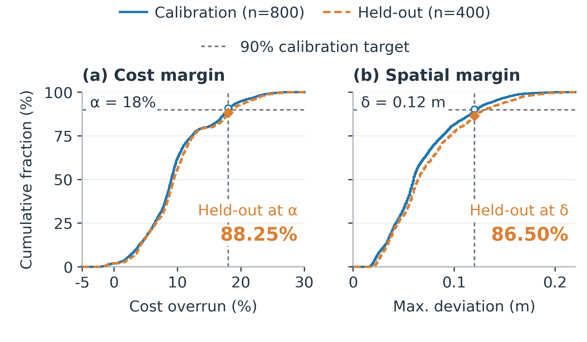

## 2026-10-26 论文协议补齐
现有1200合成配对汇总及图四保持；800/400、Q90=.18/.12m、留出353/346和联合336均复算通过。
追加条件分层bootstrap的合成数据区间：alpha[.177,.183]、delta[.119,.124]m；记录位于CCDC/data/manuscript_completion_20261026/calibration_results.json。它不是实测区间。成本统一既有代理a.u.；真实替换还需配对全窗口日志、命令与实际扰动配置。

# 裕度校准与留出检验图

本项目展示冻结低层速度控制器后，如何根据执行失配选择成本裕度α、空间裕度δ，以及固定这两个值后，另一组记录有多少落在阈值以内。它补充“裕度如何确定和如何检查”的论证，不重复主结果、模块消融或预算扫描。

**当前全部为假设数据。** 800组校准和400组留出是逐组人工构造的汇总记录；没有运行1200次仿真或真实机器人，没有恢复真实控制器或完整时序日志。留出划分用于演示检验流程，不能作为真实独立验证。图内使用论文版式，配套图注、CSV、元数据及本文保留假设性质。

## 直接查看

- [最终PDF](output/final/margin_calibration.pdf)：优先用于论文排版，88.9×52mm，单栏横向1×2。
- [最终PNG](output/final/margin_calibration.png)：2100×1228，600dpi。
- [最终SVG](output/final/margin_calibration.svg)：可编辑矢量图。
- [近似单栏预览](output/final/single_column_preview.png)：96dpi约336px宽，实际屏幕尺寸受系统缩放影响。
- [图注](output/final/caption.txt)：英文，含数据性质、定义、样本数和覆盖计数。
- [唯一绘图数据](data/paired_rollouts.csv)、[数据说明](data/README.md)、[绘图脚本](scripts/plot_margin_calibration.py)、[样式配置](config/style.json)。



## 图中每部分是什么意思

左图横轴是相对成本超支：(J_exec−J_nom)/J_nom，绘图乘100变为百分数。负值表示执行成本低于名义成本，不代表没有跟踪误差。右图横轴是同一初始条件、场景和命令序列下，名义/执行位置在时间对齐后的最大平面偏差，单位m。

纵轴是“不超过横轴这个误差值的记录占比”。例如成本横轴18%、橙线纵轴88.25%，表示400条留出记录中353条的成本超支不超过18%。它不是“成功率88.25%”。

蓝实线为800组校准，橙虚线为400组留出；它们是两组数据，不是两个导航方法。水平灰虚线是90%校准目标，竖虚线是只由校准组Q90确定的固定阈值。空心蓝圆和橙菱形在阈值处标出两个实际ECDF值。阈值文字移至左上空白区，右下直接标留出覆盖率，避免加箭头。

ECDF是精确阶梯，F(x)=count(error≤x)/n。相同数值合成一个较大跳跃，不插值、不平滑、不添加抖动。图包含全部负超支和超阈值尾部，不加无依据置信带。

## 当前结果及其边界

| 量 | 校准800组 | 留出400组 |
| --- | --- | --- |
| 成本超支中位数 | 0.09 | 0.094 |
| 成本超支Q90 | 0.18 | 0.186（不用它重新选α） |
| 空间偏差中位数 | 0.06m | 0.0645m |
| 空间偏差Q90 | 0.12m | 0.13m（不用它重新选δ） |
| 固定α=0.18的覆盖 | 727/800=90.875% | 353/400=88.25% |
| 固定δ=0.12m的覆盖 | 722/800=90.25% | 346/400=86.50% |

Q90使用排序后第ceil(0.9n)项，序号从1开始；偶数样本中位数是中间两项平均。校准覆盖略高于90%，因为阈值处有重复值且等号计入覆盖。留出覆盖低于90%保留原统计，没有反向调值或调阈值。

两项同时覆盖为校准702/800、留出336/400，仅在统计文件内部核对。边际覆盖不等于同时覆盖，更不等于导航SR、碰撞CR或预算违约BVR。主表完整方法SR73.3%、Cost88.3、BVR9%、CR15%不能从本图换算。示例绝对成本用独立示例单位，不与主表Cost数值混用。

本批数据受论文已公布的四个假设校准锚点约束。总体成本/几何相关约0.969，带有明显人工构造特征；逐项合理不等于恢复了真实噪声。旧轨迹图和总览图只用于个案逻辑对照，旧路线及其副本没有重复计入1200组。

## 数据怎么来的

1. 先冻结假设采样协议和20种条件：直线变速、宽弧、交替转弯、停走转向，分别配基准、低摩擦、延迟、噪声、混合扰动。
2. 每组单独写J_nom、成本超支百分比、最大偏差毫米值及两项具体判断；每20组写一次回顾。源文件在`data/authored/`。
3. `ingest_samples.py`展开预分配ID/条件、转换单位，并按定义计算J_exec。脚本不随机生成误差，不给旧数组统一加噪，不生成判断理由。
4. 800条校准完成全量检查后，写入`calibration_frozen.csv`和哈希清单；当时尚无留出记录。只从校准组取α/δ。
5. 再单独写400条留出值。按固定阈值统计，不为90%覆盖率安排补偿样本。
6. `paired_rollouts.csv`按冻结校准+审查后留出直接合并，是最终脚本的唯一数据入口。统计JSON为派生结果，不是另一套手工数据。

`reviews/point_reviews.jsonl`有1200条逐组记录，包含两项误差判断、关联ID、源文件行号和数值。部分短判断措辞重复，均来自人工源行，非自动模板生成。一对记录CAL-0336/TEST-0116有限精度汇总值重合，已检查来源/指令ID并在全局审查解释，没有为去重强加噪声。

## 目录及维护入口

| 目录/文件 | 用途 | 后续是否直接改 |
| --- | --- | --- |
| `data/paired_rollouts.csv` | 唯一最终绘图输入 | 建议复制新版本后改，保留已验收版 |
| `data/statistics.json` | 四条完整ECDF、阈值、覆盖计数及输入哈希 | 运行脚本重算，不手填结果 |
| `data/protocol.json` | 假设采样条件、配对和窗口定义 | 当前已冻结，改条件应新建协议版本 |
| `data/calibration_freeze.json` | 冻结阈值、800个ID及数据/协议哈希 | 历史证据，不回写 |
| `data/authored/` | 逐组原始假设值和两项判断 | 保留原记录，修订另建版本并追加理由 |
| `config/style.json` | 尺寸、颜色、字号、线宽、布局等 | 调样式改这里 |
| `scripts/` | 导入、校验、统计、绘图、审查和复现 | 改程序时检查受影响数值和外观 |
| `reviews/` | 逐组、批次、阶段、跨图和复现证据 | 追加，不抹去历史问题 |
| `output/final/` | 当前正式版式 | 保留；新重绘使用新目录 |
| `output/pilot_*`、`candidate_*`、`final_review_v1` | 试绘及版式修正历史 | 用于回溯，当前入口以final为准 |
| `output/reproduction_v1/` | 独立重绘证据 | 与final逐像素/文件哈希一致 |

## 本机运行方法

使用已有Conda解释器，无须安装或升级环境。Python3.12.4、Matplotlib3.10.8；详见`reviews/environment.json`。所有命令在PowerShell执行，变量名仅用于本项目。

```powershell
$mcalPython = 'D:/codesoftware/Miniconda/python.exe'
$mcalProject = 'C:/Users/smile/Desktop/paper/manuscripts/figures/20261025_裕度校准与独立检验图'

# 核对当前已验收版本，包括冻结校准、800/400及逐组审查
& $mcalPython "$mcalProject/scripts/validate_data.py" --final

# 重算派生统计，不生成新样本
& $mcalPython "$mcalProject/scripts/compute_statistics.py"

# 使用新输出目录，保留本次交付版；若目录已有内容请换一个新版本名
& $mcalPython "$mcalProject/scripts/plot_margin_calibration.py" `
  --statistics "$mcalProject/data/statistics.json" `
  --output "$mcalProject/output/manual_review_v1"

# 全量检查曲线与源数据的对应关系
& $mcalPython "$mcalProject/scripts/audit_figure.py" `
  "$mcalProject/output/manual_review_v1" `
  --output "$mcalProject/reviews/manual_mapping_v1.json"
```

绘图脚本可指定`--data`、`--config`、`--statistics`、`--output`；`--panel cost`只试绘成本面板。`--statistics`会检查JSON是否与输入CSV完全一致；省略它时也会直接从CSV重算。α/δ和覆盖数字均不写死在图里。

不要重跑`capture_baseline.py`、`setup_manifest.py`、`ingest_samples.py`或`audit_dataset.py release`来“刷新图片”：它们是一次性的建档/导入/发布工具。重复导入会破坏工作记录；工具已有计数或覆盖保护。

## 后续怎么改

只改颜色/字号/距离：复制样式为`config/style_v2.json`，修改配置，使用`--config`及新的输出目录。单栏宽度保持88.9mm，最小字体不低于6.5pt。改尺寸后再检查PDF，不能只看放大的PNG。

改某个假设值：先复制CSV到新版本，记录该ID旧值、新值、原因和与其他图的关联。J_nom、J_exec和cost_overrun必须满足定义式；几何单位是m。校准记录一旦变动，需重新生成本版本阈值/冻结清单，再评估留出；不能拿留出结果挑选校准值。当前`--final`验证器绑定本版清单和逐组判断，新版本还要同步自己的审查/清单路径，不应简单绕过报错。详见[data说明](data/README.md)。

换成真实实验记录：不只是把`hypothetical`改名。需真实配对日志、控制器和窗口定义、预先分组、只用真实校准组重估裕度，再固定后检查留出；取消对0.18/0.12等假设锚点的强制匹配。当前工具有假设来源保护，需要为真实版新增相应模式和证据校验。完整步骤见[真实数据替换说明](reviews/real_data_replacement.md)。

## 已完成的验收

- 1200个唯一ID、2400项误差与源行/判断匹配；800/400条件计数和冻结检查通过。
- 数值审查见[figure_numeric_audit.json](reviews/figure_numeric_audit.json)，全局关联见[stage_09_global_data.md](reviews/stage_09_global_data.md)。
- PDF已渲染查看，版式问题及修正见[stage_11_final_visual.md](reviews/stage_11_final_visual.md)。
- 独立重绘PNG逐像素相同，PDF/SVG/PNG/图注/预览哈希均一致，见[reproduction_audit.json](reviews/reproduction_audit.json)。
- 38项计划及工作记录位于`../../plan/margin_calibration_figure_20261025_plan.json`；最终验收见[stage_12_delivery.md](reviews/stage_12_delivery.md)。

本轮交付独立绘图工程，没有插入论文、编译整篇或提交Git。

## 后续论文接入（2026-10-25）

独立绘图任务完成后，已按用户另行授权将最终PDF原样复制至`../../CCDC/images/1020/margin_calibration.pdf`，在1020稿件的“Execution Mismatch and Component Analysis”小节单栏插入，并补充校准/留出分析和简短图注。新图为第5页图4，全文仍8页；数据和原成图未改。接入修改不属于原38项独立绘图计划，原验收清单保留为当时的快照。最新编译稿见`../../CCDC/output/1020/main.pdf`。
