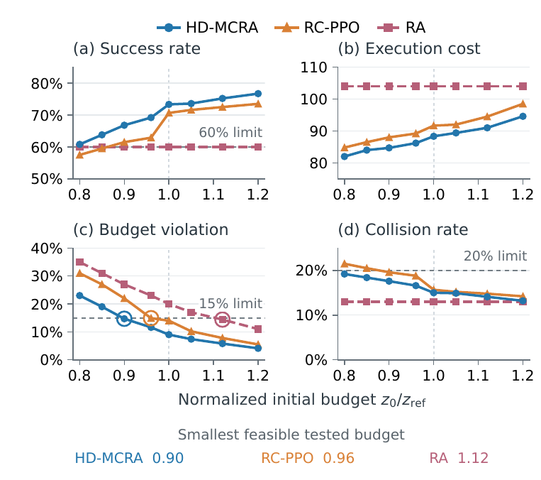

# 预算扫描图绘图项目

更新日期：2026-10-25。对已有预算扫描的96个假设值逐点审查，保留全部原值，按88×78mm单栏尺寸重绘为四面板图。24项计划任务已完成。

- 最终图片：[PDF](output/final/budget_sweep.pdf)、[SVG](output/final/budget_sweep.svg)、[PNG](output/final/budget_sweep.png)。
- 配套说明：[英文图注与中文解释](output/final/caption.md)、[输入数据说明](data/README.md)。
- 验收证据：[视觉终审](reviews/final_visual_review.md)、[数值与跨图验收](reviews/final_consistency_check.json)、[独立复现检查](reviews/reproduction_check.json)。



## 新增横向四图版本

按后续要求新增一行四图：SR → Cost → BVR → CR。尺寸180×50mm，共享图例、横轴名称和底部预算摘要；适合通栏显示。原88×78mm四宫格及其全部输出保持原样。

横版文件：[PDF](output/horizontal_v1/budget_sweep.pdf)、[SVG](output/horizontal_v1/budget_sweep.svg)、[PNG](output/horizontal_v1/budget_sweep.png)。96个实际曲线点、阈值和预算摘要与四宫格完全一致；假设数据性质仍见同目录图注。原`output/final`的6个文件已核对SHA256，均未改动。

横版使用独立配置`config/style_horizontal.json`，原`config/style.json`继续生成四宫格。复现到新的目录：

```powershell
& 'D:/codesoftware/Miniconda/python.exe' -B '绘图/20261025_预算扫描图/scripts/plot_budget_sweep.py' --style '绘图/20261025_预算扫描图/config/style_horizontal.json' --output-dir '绘图/20261025_预算扫描图/output/horizontal_v2'
```

绘图脚本新增可选网格与文字位置配置，默认仍是2×2。旧清单记录的是当时脚本哈希；横版清单记录本次脚本哈希，原图和原始输入哈希均保持不变。

## 这张图怎样读

横轴为归一化初始预算，三种颜色分别对应HD-MCRA、RC-PPO、RA。上排是成功率SR与执行成本，下排是预算违约率BVR与碰撞率CR。SR不低于60%、CR不高于20%、BVR不高于15%时，才算共同通过。

底部0.90、0.96、1.12是三种方法各自最小通过的已测试候选；BVR面板的空心圈只是标出这些候选，不表示只看BVR，也不是连续最优预算。预算1.00处的12个值与主表和多方法指标图对齐。

低成本需要结合成功率解释；失败提前结束也可能降低累计成本。RA复用相同轨迹，所以SR、成本与CR不随预算变化。图中没有误差带：当前没有逐预算的真实区间依据。

## 当前数据与绘图入口

| 文件 | 用途 |
| --- | --- |
| `data/reviewed_points.jsonl` | 唯一的当前绘图数值入口，96点，比例以0–1存储 |
| `data/plot_protocol.json` | 方法、预算、指标、阈值、参考锚点和统计口径 |
| `reviews/point_review.jsonl` | 每点的独立判断、关联指标、原Excel单元格及采纳值 |
| `config/style.json` | 尺寸、字体、颜色、点形、坐标范围、面板位置 |
| `scripts/plot_budget_sweep.py` | 读取数据、校验、绘图并导出PDF/SVG/PNG |
| `scripts/check_budget_data.py` | 数值约束、参考锚点、共同通过预算和审查完整性检查 |

Excel副本及来源快照是保留的基线，不是新版脚本的直接输入。修改它们不会自动改变新版图。

## 本机重绘命令

在`C:/Users/smile/Desktop/paper`下打开PowerShell，输出目录必须使用尚不存在的新名称：

```powershell
& 'D:/codesoftware/Miniconda/python.exe' -B '绘图/20261025_预算扫描图/scripts/plot_budget_sweep.py' --check-only --output-dir '绘图/20261025_预算扫描图/output/check_only'
& 'D:/codesoftware/Miniconda/python.exe' -B '绘图/20261025_预算扫描图/scripts/plot_budget_sweep.py' --output-dir '绘图/20261025_预算扫描图/output/new_version'
```

第一条只检查，不创建输出目录；第二条导出图、图注、PDF重渲染预览和`render_manifest.json`。清单记录实际绘制的96个坐标和输入哈希，便于追溯。加`--pilot`可只画SR/BVR小样。

当前环境为Python3.12.4、Matplotlib3.10.8、NumPy2.2.4和PyMuPDF1.27.2.3，使用本机已有Miniconda。脚本优先用已有Poppler生成PDF预览；没有Poppler时使用PyMuPDF。工作簿只用于来源核对，正常重绘不读取Excel。

## 后续怎么改

| 修改内容 | 修改入口和复核重点 |
| --- | --- |
| 单个数值 | `data/reviewed_points.jsonl`对应ID的`value`；比例写0.7333而不是73.33。按下述流程追加审查记录，不能只改数字后绕过检查 |
| 颜色、点形、线宽 | `config/style.json`的`colors`、`markers`、`linestyles`、`line_width`和`marker_size`；同方法与全文其他图保持一致 |
| 尺寸、字体、留白 | 同文件的`width_mm`、`height_mm`、各字体字段、`panels`和图例/摘要位置；新版本重新检查88mm单栏可读性 |
| 轴范围、刻度、标题 | 同文件的`limits`、`ticks`、`x_ticks`和`titles`；范围必须容纳全部点及阈值，非零起点在图注解释 |
| 三项验收阈值 | `data/plot_protocol.json`的`thresholds`；图中阈值线与最小预算自动重算，图注中的解释及校验边界样例需同步修改 |
| 图注与解释 | `scripts/plot_budget_sweep.py`的`caption()`；图注的阈值描述、首次通过余量和局部趋势解释是本版文字，数据变化后必须复核，不能直接沿用 |

修改假设值时，保留`baseline_points.json`和旧工作记录，在`reviews/point_review.jsonl`末尾追加该点的新revision，关联旧revision并记录新采纳值和理由；相应更新当前点的`review_revision`及`review_decision`。绘图会检查最终数值与最新采纳记录一致。修改预算1.00处数值，还须同时核查主表及指标图的三个场景均值，不能只为通过校验而改锚点。

每次修改后先执行上述`--check-only`，再绘制到新版本目录；复核实际曲线点、图注、阈值和跨图关系。`data/reviewed_summary.json`与`reviews/*check.json`是当前验收快照，不会随手工改数自动刷新，数据变化后需重新生成对应审查证据。

本脚本当前明确针对3种方法×8档预算×4项指标的假设数据。替换成真实实验时，需要保留真实日志出处，重新计算同口径汇总并更新数据协议、审查记录和图注；校验器当前会拒绝非`hypothetical`协议。届时同步改校验规则及PDF/清单的数据性质元信息，不能仅删除“假设”标签。新增方法、预算档或误差区间也要同步扩展96点契约。这些是后续实验接入工作。

## 版本与论文关系

`output/pilot_v1`为两面板小样，`candidate_v1`为通过审查的四面板候选，`final`原样收录候选，`reproduction_v1`为同输入独立重绘。最终PDF/SVG/PNG和重渲染预览逐文件哈希一致；96个实际曲线坐标、输入哈希与图注也一致。

根据后续授权，当前论文已引用横版的字节副本`CCDC/images/1020/budget_sweep_horizontal.pdf`，按`width=\columnwidth`单栏放置，并已重新编译。论文图注保留假设性质、共同阈值及离散候选口径。原`figure_budget_sweep_v3.pdf`、本工程四宫格`output/final`及横版原文件均保留。横版宽180mm，直接缩到论文一栏后字体会相应变小。图形为矢量输出，PNG只用于预览。

## 数据性质与解释边界

当前是经逻辑审查的假设数据，未完成实测验证。图面采用论文版式，数据性质统一保留在配套图注、数据协议与PDF元信息中。分享当前图应附图注。

首次BVR通过余量分别只有0.3、0.1、0.6个百分点，不能称为统计上稳健达标。RC-PPO在预算0.96至1.00的成功率变化保留原假设，待真实日志核实；没有人为平滑。SR与Cost纵轴采用非零起点，不能跨面板按视觉斜率比较。

完整绘图核查见 [阶段复核](reviews/stage_reviews.md)、[跨图一致性](reviews/cross_figure_check.md)、[数据验收](reviews/data_acceptance.json)。这些记录对应绘图完成时的状态；后续论文接入与单栏编译记录见[CCDC稿件说明](../../CCDC/latex/1020/README.md)。
